# CD-Manual Kanton Solothurn

Transkription des Miro-Boards «CD-Manual Kanton Solothurn» (<https://miro.com/app/board/uXjVKj6w4cc=/>) – Stand der Extraktion: 23.10.2026.

Die 38 Seiten (Frames) sind in der Reihenfolge des Boards wiedergegeben. Seitenverweise «S. nn» beziehen sich auf die Frame-Nummer im Dateinamen (`frames/nn-….png`). Wortlaut, Rechtschreibung und Zeichensetzung des Originals sind unverändert übernommen. Bildbeschreibungen sind mit *Abbildung:* gekennzeichnet, nicht lesbarer Kleinsttext mit [unleserlich]. Die Inhaltsseiten tragen oben rechts die Kapitelbezeichnung mit Pfeil (z. B. «1 LOGO →», im Kapitel 4 «4 GRUNDSATZ →»); die Don'ts-Seiten und die Seite «Wortabstand» tragen stattdessen nur einen Rücksprungpfeil (↪). Links am Seitenrand steht jeweils ein rotes (auf roten Seiten weisses) Quadrat.


## Inhaltsverzeichnis

- [Titel und Inhalt](#titel-und-inhalt)
  - [Titelseite](#titelseite) (S. 00)
  - [Inhalt](#inhalt) (S. 01)
- [1 Logo](#1-logo)
  - [Logo – Kapitelübersicht](#logo--kapitelübersicht) (S. 10)
  - [Logo-Varianten](#logo-varianten) (S. 11)
  - [Sprach-Varianten](#sprach-varianten) (S. 12)
  - [Logo-Grössen](#logo-grössen) (S. 13)
  - [Logo-Anwendung](#logo-anwendung) (S. 14)
  - [Logo Don'ts](#logo-donts) (S. 15)
- [2 Typografie](#2-typografie)
  - [Typografie – Kapitelübersicht](#typografie--kapitelübersicht) (S. 20)
  - [Schriften](#schriften) (S. 21)
  - [Schrift-Schnitte | Hauptschrift](#schrift-schnitte--hauptschrift) (S. 22)
  - [Schrift-Schnitte | Zusatzschrift](#schrift-schnitte--zusatzschrift) (S. 23)
  - [Satzzeichen](#satzzeichen) (S. 24)
  - [Wortabstand](#wortabstand) (S. 25)
- [3 Farben](#3-farben)
  - [Farben – Kapitelübersicht](#farben--kapitelübersicht) (S. 30)
  - [Farben](#farben) (S. 31)
  - [Farben für Grafiken](#farben-für-grafiken) (S. 32)
  - [Farben Don'ts](#farben-donts) (S. 33)
- [4 Grundsätze](#4-grundsätze)
  - [Grundsätze – Kapitelübersicht](#grundsätze--kapitelübersicht) (S. 40)
  - [Absender](#absender) (S. 41)
  - [Textanwendung](#textanwendung) (S. 42)
  - [Bildsprache](#bildsprache) (S. 43)
  - [Grundsätze Don'ts](#grundsätze-donts) (S. 44)
- [5 Anwendung](#5-anwendung)
  - [Anwendung – Kapitelübersicht](#anwendung--kapitelübersicht) (S. 50)
  - [Briefpapier](#briefpapier) (S. 51)
  - [Visitenkarten](#visitenkarten) (S. 52)
  - [Adressen](#adressen) (S. 53)
  - [Kuverts](#kuverts) (S. 54)
  - [Umschläge](#umschläge) (S. 55)
  - [Umschlag | A4](#umschlag--a4) (S. 56)
  - [Umschlag | A5](#umschlag--a5) (S. 57)
  - [Umschlag | A6/5](#umschlag--a65) (S. 58)
  - [Stelleninserate](#stelleninserate) (S. 59)
  - [Stelleninserat | Full](#stelleninserat--full) (S. 60)
  - [Stelleninserat | Short](#stelleninserat--short) (S. 61)
  - [Stelleninserat | Teaser](#stelleninserat--teaser) (S. 62)
  - [PowerPoint](#powerpoint) (S. 63)
  - [Anwendung Don'ts](#anwendung-donts) (S. 64)
- [Kurzreferenz für digitale Anwendungen](#kurzreferenz-für-digitale-anwendungen)

## Titel und Inhalt

### Titelseite


**Corporate Design Manual** (rot, als grosser Titel gesetzt)

Gesamtübersicht\
Arbeitsinstrument für die Verwaltung und die Druckindustrie

*Abbildung:* Logo «KANTON solothurn» (farbig) oben rechts, rotes Quadrat am linken Rand, roter Pfeil rechts.

### Inhalt

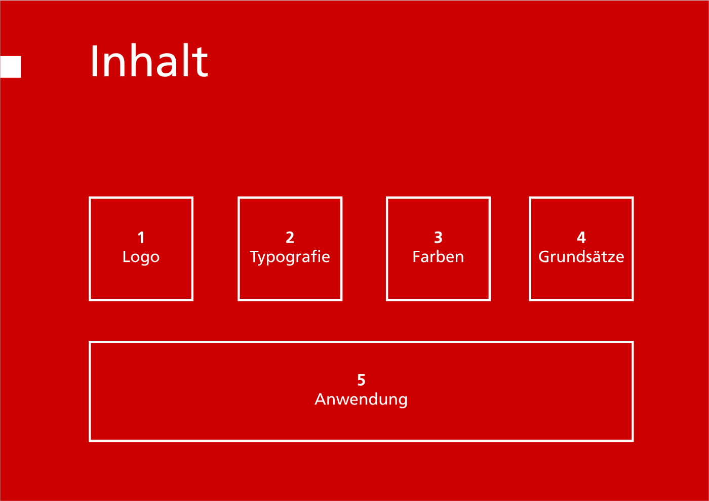

Rote Seite mit fünf weiss umrandeten Kacheln:

1. [Logo](#1-logo)
2. [Typografie](#2-typografie)
3. [Farben](#3-farben)
4. [Grundsätze](#4-grundsätze)
5. [Anwendung](#5-anwendung) (breite Kachel unter den ersten vier)

## 1 Logo

### Logo – Kapitelübersicht

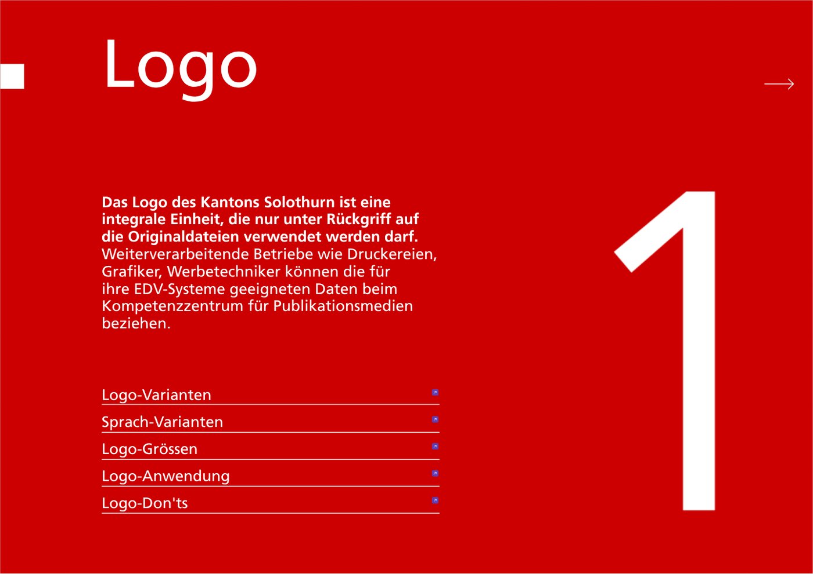

**Das Logo des Kantons Solothurn ist eine integrale Einheit, die nur unter Rückgriff auf die Originaldateien verwendet werden darf.**

Weiterverarbeitende Betriebe wie Druckereien, Grafiker, Werbetechniker können die für ihre EDV-Systeme geeigneten Daten beim Kompetenzzentrum für Publikationsmedien beziehen.

Unterseiten:

- [Logo-Varianten](#logo-varianten)
- [Sprach-Varianten](#sprach-varianten)
- [Logo-Grössen](#logo-grössen)
- [Logo-Anwendung](#logo-anwendung)
- [Logo-Don'ts](#logo-donts)

*Abbildung:* Rote Seite mit grosser weisser Ziffer «1».

### Logo-Varianten

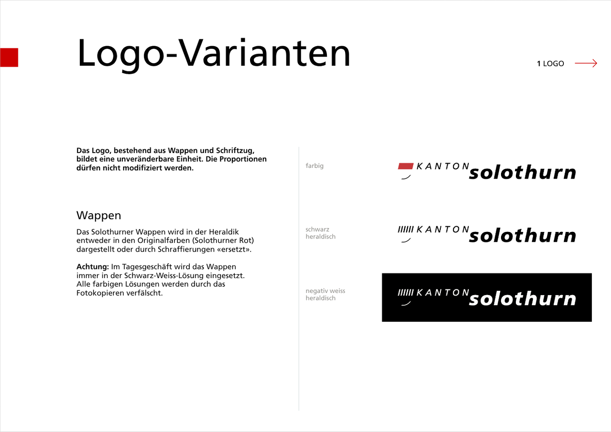

**Das Logo, bestehend aus Wappen und Schriftzug, bildet eine unveränderbare Einheit. Die Proportionen dürfen nicht modifiziert werden.**

**Wappen**

Das Solothurner Wappen wird in der Heraldik entweder in den Originalfarben (Solothurner Rot) dargestellt oder durch Schraffierungen «ersetzt».

**Achtung:** Im Tagesgeschäft wird das Wappen immer in der Schwarz-Weiss-Lösung eingesetzt. Alle farbigen Lösungen werden durch das Fotokopieren verfälscht.

| Variante | Abbildung |
|---|---|
| farbig | Wappen als roter Balken, Schriftzug «KANTON solothurn» schwarz auf weiss |
| schwarz heraldisch | Wappen als senkrechte Schraffur, alles schwarz auf weiss |
| negativ weiss heraldisch | Schraffiertes Wappen und Schriftzug weiss auf schwarzer Fläche |

*Abbildung:* Logo farbig, schwarz heraldisch, negativ weiss heraldisch.

### Sprach-Varianten

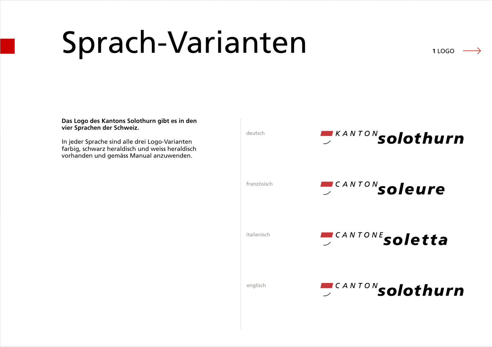

**Das Logo des Kantons Solothurn gibt es in den vier Sprachen der Schweiz.**

In jeder Sprache sind alle drei Logo-Varianten farbig, schwarz heraldisch und weiss heraldisch vorhanden und gemäss Manual anzuwenden.

| Sprache | Schriftzug |
|---|---|
| deutsch | KANTON solothurn |
| französisch | CANTON soleure |
| italienisch | CANTONE soletta |
| englisch | CANTON solothurn |

*Abbildung:* Die vier Sprachversionen, jeweils in der farbigen Variante.

### Logo-Grössen

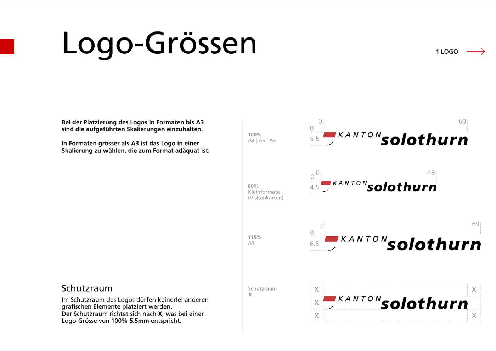

**Bei der Platzierung des Logos in Formaten bis A3 sind die aufgeführten Skalierungen einzuhalten.**

**In Formaten grösser als A3 ist das Logo in einer Skalierung zu wählen, die zum Format adäquat ist.**

| Skalierung | Format | Logobreite (Massangabe in der Abbildung) | Höhenmass am Wappen (Massangabe in der Abbildung) |
|---|---|---|---|
| **100%** | A4 \| A5 \| A6 | 0–60 | 0–5.5 |
| **80%** | Kleinformate (Visitenkarten) | 0–48 | 0–4.5 |
| **115%** | A3 | 0–69 | 0–6.5 |

**Schutzraum**

Im Schutzraum des Logos dürfen keinerlei anderen grafischen Elemente platziert werden.
Der Schutzraum richtet sich nach **X**, was bei einer Logo-Grösse von 100% **5.5mm** entspricht.

*Abbildung:* Das Logo in den drei Skalierungen mit Masslinien (ohne Einheit); darunter «Schutzraum X»: das Logo ist von einem Raster aus X-Feldern umgeben (links drei X übereinander, rechts oben und unten je ein X), d. h. ein Abstand von X rundum.

### Logo-Anwendung

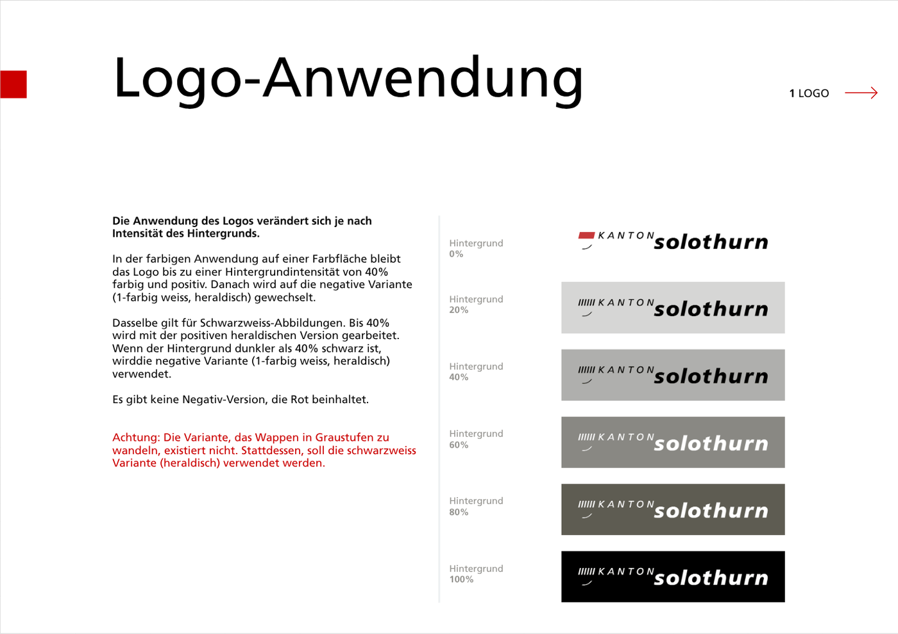

**Die Anwendung des Logos verändert sich je nach Intensität des Hintergrunds.**

In der farbigen Anwendung auf einer Farbfläche bleibt das Logo bis zu einer Hintergrundintensität von 40% farbig und positiv. Danach wird auf die negative Variante (1-farbig weiss, heraldisch) gewechselt.

Dasselbe gilt für Schwarzweiss-Abbildungen. Bis 40% wird mit der positiven heraldischen Version gearbeitet. Wenn der Hintergrund dunkler als 40% schwarz ist, wirddie negative Variante (1-farbig weiss, heraldisch) verwendet.

Es gibt keine Negativ-Version, die Rot beinhaltet.

Achtung: Die Variante, das Wappen in Graustufen zu wandeln, existiert nicht. Stattdessen, soll die schwarzweiss Variante (heraldisch) verwendet werden. *(im Original rot gesetzt)*

| Hintergrund | Abgebildete Logo-Variante |
|---|---|
| **0%** | farbig, auf Weiss |
| **20%** | schwarz heraldisch, auf hellem Grau |
| **40%** | schwarz heraldisch, auf Grau |
| **60%** | weiss heraldisch (negativ), auf dunklem Grau |
| **80%** | weiss heraldisch (negativ), auf sehr dunklem Grau |
| **100%** | weiss heraldisch (negativ), auf Schwarz |

*Abbildung:* Sechs Graustufenflächen von 0% bis 100% mit der jeweils korrekten Logo-Variante.

### Logo Don'ts

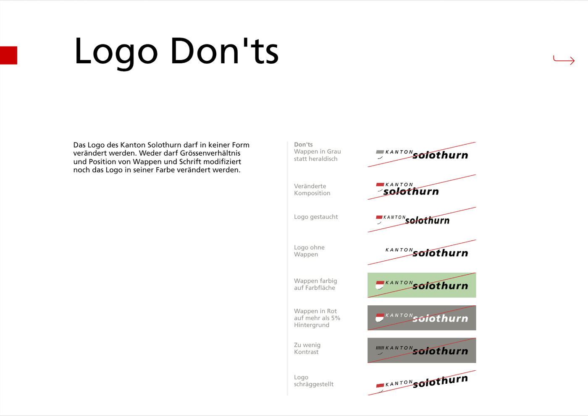

Das Logo des Kanton Solothurn darf in keiner Form verändert werden. Weder darf Grössenverhältnis und Position von Wappen und Schrift modifiziert noch das Logo in seiner Farbe verändert werden.

**Don'ts**

| Don't | Abbildung |
|---|---|
| Wappen in Grau statt heraldisch | Wappen als graue Fläche |
| Veränderte Komposition | «solothurn» unter statt neben «KANTON» gesetzt |
| Logo gestaucht | Logo horizontal zusammengedrückt |
| Logo ohne Wappen | nur der Schriftzug |
| Wappen farbig auf Farbfläche | farbiges Wappen auf hellgrüner Fläche |
| Wappen in Rot auf mehr als 5% Hintergrund | farbiges Wappen auf grauer Fläche |
| Zu wenig Kontrast | schwarz heraldisches Logo auf mittelgrauer Fläche |
| Logo schräggestellt | Logo gedreht |

*Abbildung:* Acht Fehlanwendungen, jede mit einer roten Diagonale durchgestrichen.

## 2 Typografie

### Typografie – Kapitelübersicht

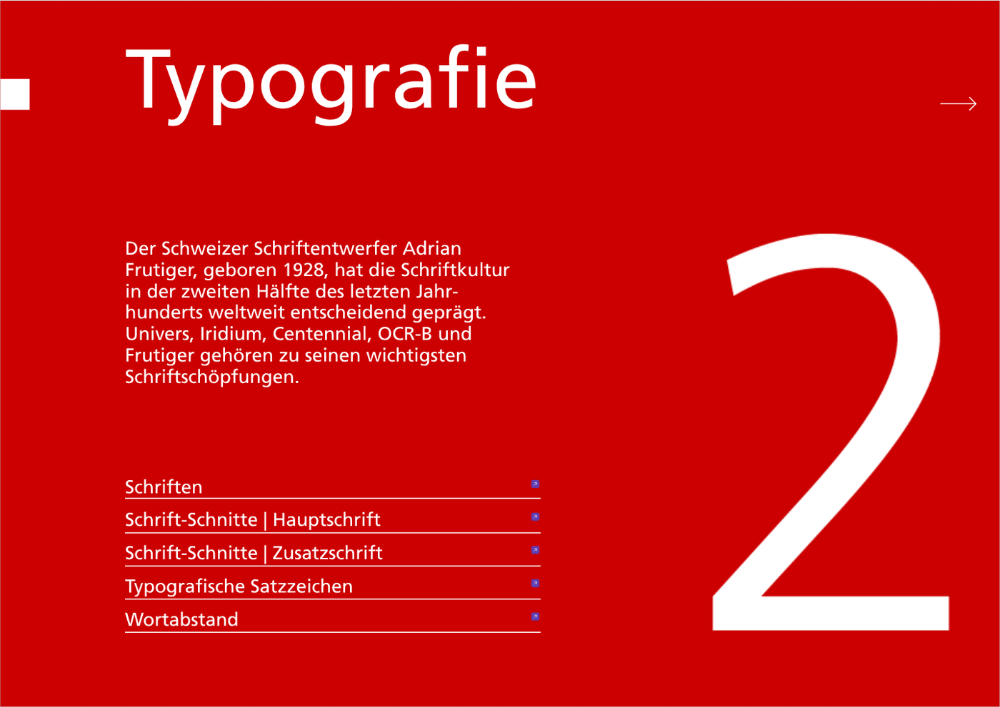

Der Schweizer Schriftentwerfer Adrian Frutiger, geboren 1928, hat die Schriftkultur in der zweiten Hälfte des letzten Jahrhunderts weltweit entscheidend geprägt. Univers, Iridium, Centennial, OCR-B und Frutiger gehören zu seinen wichtigsten Schriftschöpfungen.

Unterseiten:

- [Schriften](#schriften)
- [Schrift-Schnitte | Hauptschrift](#schrift-schnitte--hauptschrift)
- [Schrift-Schnitte | Zusatzschrift](#schrift-schnitte--zusatzschrift)
- [Typografische Satzzeichen](#satzzeichen)
- [Wortabstand](#wortabstand)

*Abbildung:* Rote Seite mit grosser weisser Ziffer «2».

### Schriften

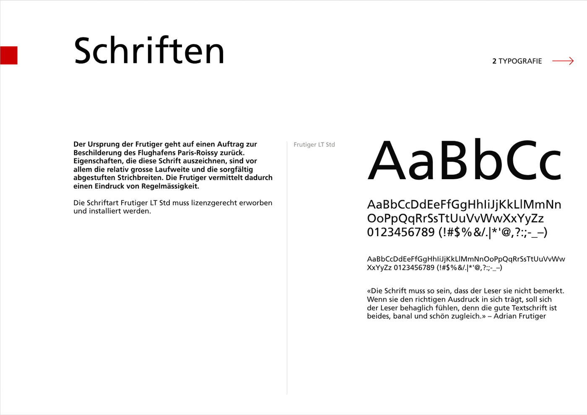

**Der Ursprung der Frutiger geht auf einen Auftrag zur Beschilderung des Flughafens Paris-Roissy zurück. Eigenschaften, die diese Schrift auszeichnen, sind vor allem die relativ grosse Laufweite und die sorgfältig abgestuften Strichbreiten. Die Frutiger vermittelt dadurch einen Eindruck von Regelmässigkeit.**

Die Schriftart Frutiger LT Std muss lizenzgerecht erworben und installiert werden.

**Frutiger LT Std** (Schriftmuster)

```
AaBbCc
AaBbCcDdEeFfGgHhIiJjKkLlMmNn
OoPpQqRrSsTtUuVvWwXxYyZz
0123456789 (!#$%&/.|*'@,?:;-_–)
```

«Die Schrift muss so sein, dass der Leser sie nicht bemerkt. Wenn sie den richtigen Ausdruck in sich trägt, soll sich der Leser behaglich fühlen, denn die gute Textschrift ist beides, banal und schön zugleich.» – Adrian Frutiger

*Abbildung:* Schriftmuster in drei Grössen (gross «AaBbCc», mittel und klein das ganze Alphabet mit Ziffern und Sonderzeichen).

### Schrift-Schnitte | Hauptschrift

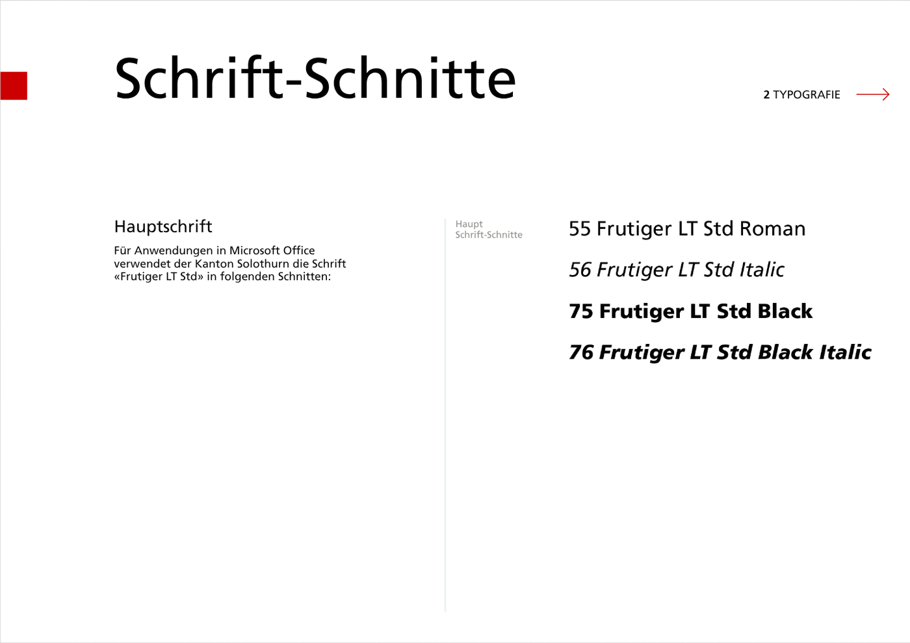

Seitentitel: «Schrift-Schnitte»

**Hauptschrift**

Für Anwendungen in Microsoft Office verwendet der Kanton Solothurn die Schrift «Frutiger LT Std» in folgenden Schnitten:

**Haupt Schrift-Schnitte**

| Nr. | Schnitt |
|---|---|
| 55 | Frutiger LT Std Roman |
| 56 | Frutiger LT Std Italic |
| 75 | Frutiger LT Std Black |
| 76 | Frutiger LT Std Black Italic |

*Abbildung:* Jeder Schnitt ist in sich selbst gesetzt.

### Schrift-Schnitte | Zusatzschrift

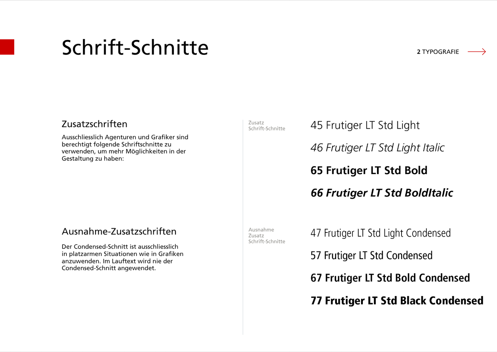

Seitentitel: «Schrift-Schnitte»

**Zusatzschriften**

Ausschliesslich Agenturen und Grafiker sind berechtigt folgende Schriftschnitte zu verwenden, um mehr Möglichkeiten in der Gestaltung zu haben:

**Zusatz Schrift-Schnitte**

| Nr. | Schnitt |
|---|---|
| 45 | Frutiger LT Std Light |
| 46 | Frutiger LT Std Light Italic |
| 65 | Frutiger LT Std Bold |
| 66 | Frutiger LT Std BoldItalic |

**Ausnahme-Zusatzschriften**

Der Condensed-Schnitt ist ausschliesslich in platzarmen Situationen wie in Grafiken anzuwenden. Im Lauftext wird nie der Condensed-Schnitt angewendet.

**Ausnahme Zusatz Schrift-Schnitte**

| Nr. | Schnitt |
|---|---|
| 47 | Frutiger LT Std Light Condensed |
| 57 | Frutiger LT Std Condensed |
| 67 | Frutiger LT Std Bold Condensed |
| 77 | Frutiger LT Std Black Condensed |

*Abbildung:* Jeder Schnitt ist in sich selbst gesetzt.

### Satzzeichen

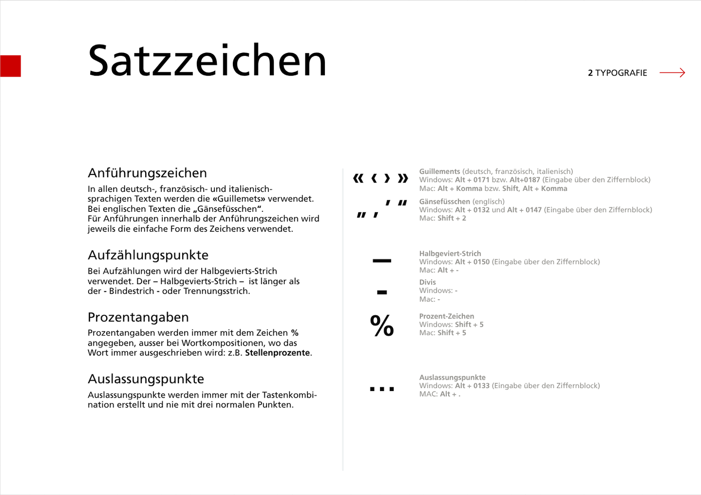

**Anführungszeichen**

In allen deutsch-, französisch- und italienischsprachigen Texten werden die «Guillemets» verwendet.
Bei englischen Texten die „Gänsefüsschen“.
Für Anführungen innerhalb der Anführungszeichen wird jeweils die einfache Form des Zeichens verwendet.

**Aufzählungspunkte**

Bei Aufzählungen wird der Halbgevierts-Strich verwendet. Der – Halbgevierts-Strich –  ist länger als der - Bindestrich - oder Trennungsstrich.

**Prozentangaben**

Prozentangaben werden immer mit dem Zeichen **%** angegeben, ausser bei Wortkompositionen, wo das Wort immer ausgeschrieben wird: z.B. **Stellenprozente**.

**Auslassungspunkte**

Auslassungspunkte werden immer mit der Tastenkombination erstellt und nie mit drei normalen Punkten.

**Zeichen und Eingabe (rechte Spalte)**

| Zeichen | Bezeichnung | Windows | Mac |
|---|---|---|---|
| « ‹ › » | **Guillemets** (deutsch, französisch, italienisch) | **Alt + 0171** bzw. **Alt+0187** (Eingabe über den Ziffernblock) | **Alt + Komma** bzw. **Shift, Alt + Komma** |
| „ ‚ ‘ “ | **Gänsefüsschen** (englisch) | **Alt + 0132** und **Alt + 0147** (Eingabe über den Ziffernblock) | **Shift + 2** |
| – | **Halbgeviert-Strich** | **Alt + 0150** (Eingabe über den Ziffernblock) | **Alt + -** |
| - | **Divis** | **-** | **-** |
| % | **Prozent-Zeichen** | **Shift + 5** | **Shift + 5** |
| … | **Auslassungspunkte** | **Alt + 0133** (Eingabe über den Ziffernblock) | «MAC:» **Alt + .** |

### Wortabstand

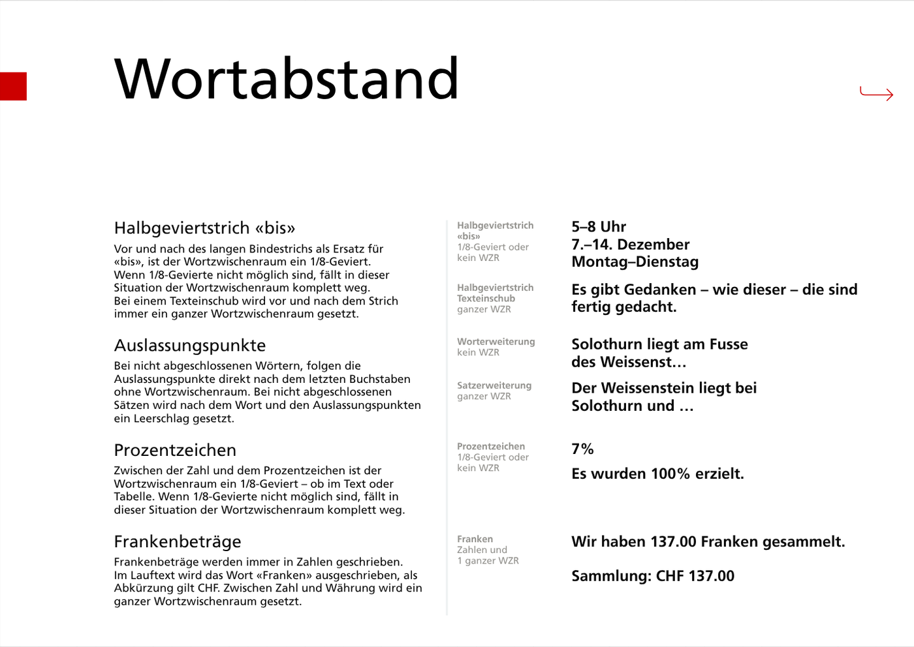

**Halbgeviertstrich «bis»**

Vor und nach des langen Bindestrichs als Ersatz für «bis», ist der Wortzwischenraum ein 1/8-Geviert.
Wenn 1/8-Gevierte nicht möglich sind, fällt in dieser Situation der Wortzwischenraum komplett weg.
Bei einem Texteinschub wird vor und nach dem Strich immer ein ganzer Wortzwischenraum gesetzt.

**Auslassungspunkte**

Bei nicht abgeschlossenen Wörtern, folgen die Auslassungspunkte direkt nach dem letzten Buchstaben ohne Wortzwischenraum. Bei nicht abgeschlossenen Sätzen wird nach dem Wort und den Auslassungspunkten ein Leerschlag gesetzt.

**Prozentzeichen**

Zwischen der Zahl und dem Prozentzeichen ist der Wortzwischenraum ein 1/8-Geviert – ob im Text oder Tabelle. Wenn 1/8-Gevierte nicht möglich sind, fällt in dieser Situation der Wortzwischenraum komplett weg.

**Frankenbeträge**

Frankenbeträge werden immer in Zahlen geschrieben.
Im Lauftext wird das Wort «Franken» ausgeschrieben, als Abkürzung gilt CHF. Zwischen Zahl und Währung wird ein ganzer Wortzwischenraum gesetzt.

**Beispiele (mittlere und rechte Spalte)**

| Fall | Wortzwischenraum (WZR) | Beispiel |
|---|---|---|
| Halbgeviertstrich «bis» | 1/8-Geviert oder kein WZR | 5–8 Uhr<br>7.–14. Dezember<br>Montag–Dienstag |
| Halbgeviertstrich Texteinschub | ganzer WZR | Es gibt Gedanken – wie dieser – die sind fertig gedacht. |
| Worterweiterung | kein WZR | Solothurn liegt am Fusse des Weissenst… |
| Satzerweiterung | ganzer WZR | Der Weissenstein liegt bei Solothurn und … |
| Prozentzeichen | 1/8-Geviert oder kein WZR | 7%<br>Es wurden 100% erzielt. |
| Franken | Zahlen und 1 ganzer WZR | Wir haben 137.00 Franken gesammelt.<br>Sammlung: CHF 137.00 |

## 3 Farben

### Farben – Kapitelübersicht

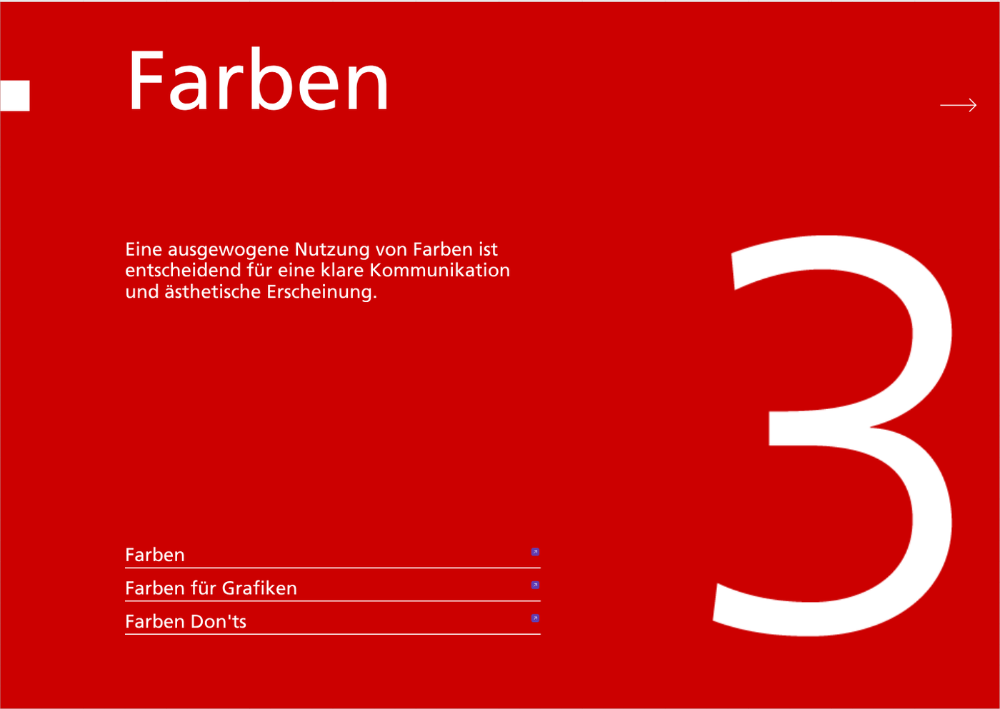

Eine ausgewogene Nutzung von Farben ist entscheidend für eine klare Kommunikation und ästhetische Erscheinung.

Unterseiten:

- [Farben](#farben)
- [Farben für Grafiken](#farben-für-grafiken)
- [Farben Don'ts](#farben-donts)

*Abbildung:* Rote Seite mit grosser weisser Ziffer «3».

### Farben

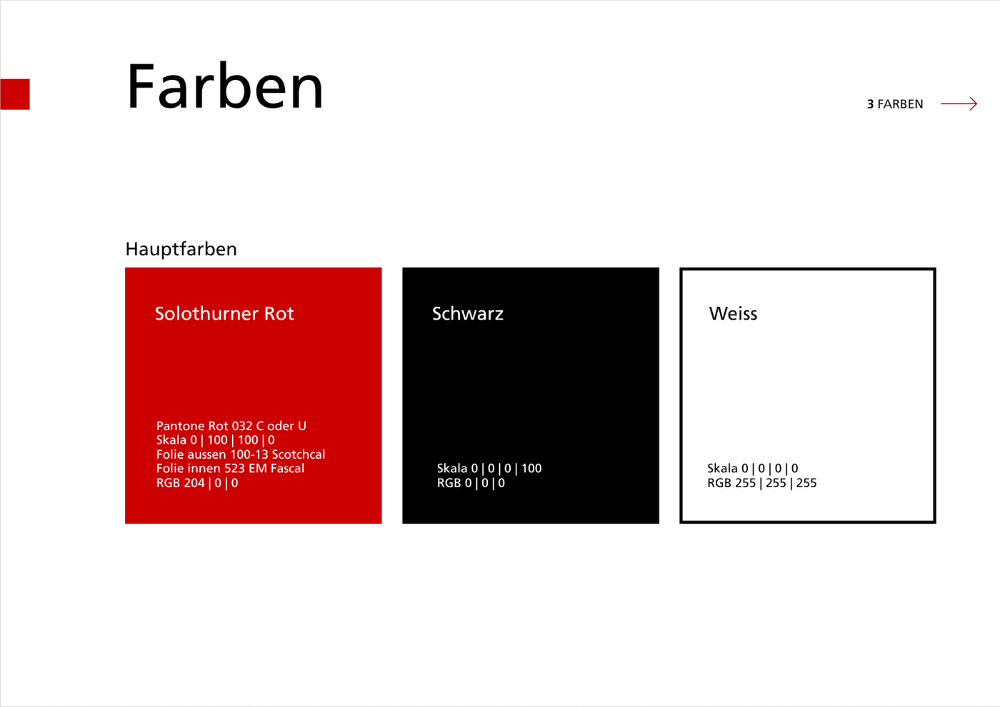

**Hauptfarben**

| Farbe | Pantone | Skala | Folie aussen | Folie innen | RGB |
|---|---|---|---|---|---|
| Solothurner Rot | Pantone Rot 032 C oder U | 0 \| 100 \| 100 \| 0 | 100-13 Scotchcal | 523 EM Fascal | 204 \| 0 \| 0 |
| Schwarz | – | 0 \| 0 \| 0 \| 100 | – | – | 0 \| 0 \| 0 |
| Weiss | – | 0 \| 0 \| 0 \| 0 | – | – | 255 \| 255 \| 255 |

*Abbildung:* Drei Farbfelder (rot, schwarz, weiss mit schwarzem Rahmen) mit den Werten; «–» = auf der Seite keine Angabe.

### Farben für Grafiken

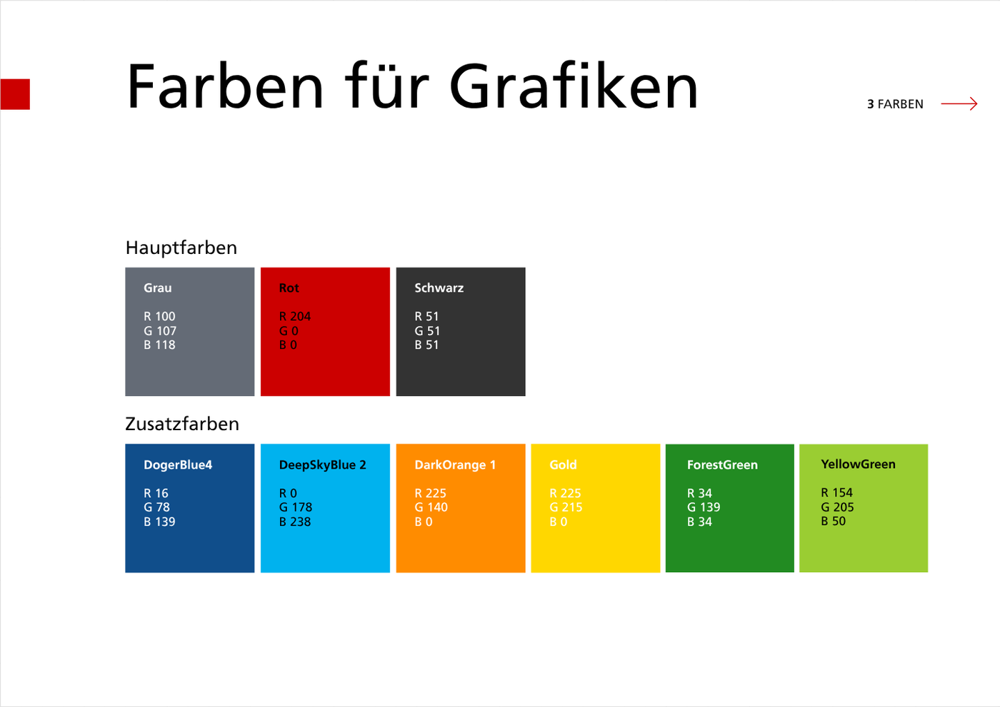

**Hauptfarben**

| Name | R | G | B |
|---|---|---|---|
| Grau | 100 | 107 | 118 |
| Rot | 204 | 0 | 0 |
| Schwarz | 51 | 51 | 51 |

**Zusatzfarben**

| Name | R | G | B |
|---|---|---|---|
| DogerBlue4 | 16 | 78 | 139 |
| DeepSkyBlue 2 | 0 | 178 | 238 |
| DarkOrange 1 | 225 | 140 | 0 |
| Gold | 225 | 215 | 0 |
| ForestGreen | 34 | 139 | 34 |
| YellowGreen | 154 | 205 | 50 |

*Abbildung:* Neun Farbfelder mit Name und RGB-Werten; für diese Farben sind nur RGB-Werte angegeben.

### Farben Don'ts

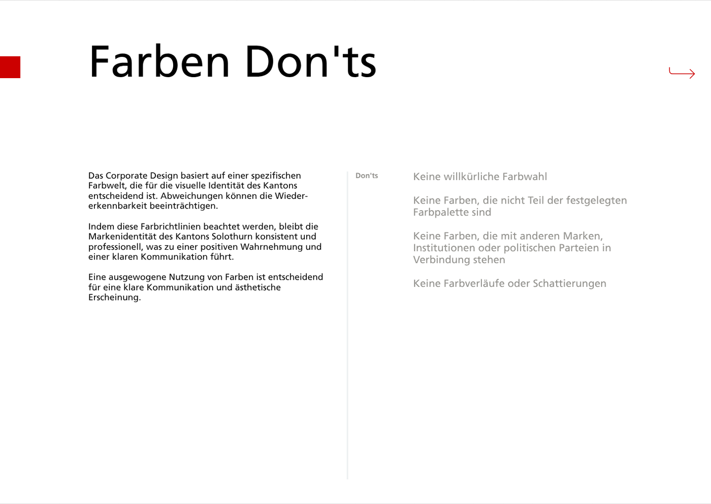

Das Corporate Design basiert auf einer spezifischen Farbwelt, die für die visuelle Identität des Kantons entscheidend ist. Abweichungen können die Wiedererkennbarkeit beeinträchtigen.

Indem diese Farbrichtlinien beachtet werden, bleibt die Markenidentität des Kantons Solothurn konsistent und professionell, was zu einer positiven Wahrnehmung und einer klaren Kommunikation führt.

Eine ausgewogene Nutzung von Farben ist entscheidend für eine klare Kommunikation und ästhetische Erscheinung.

**Don'ts**

- Keine willkürliche Farbwahl
- Keine Farben, die nicht Teil der festgelegten Farbpalette sind
- Keine Farben, die mit anderen Marken, Institutionen oder politischen Parteien in Verbindung stehen
- Keine Farbverläufe oder Schattierungen

## 4 Grundsätze

### Grundsätze – Kapitelübersicht

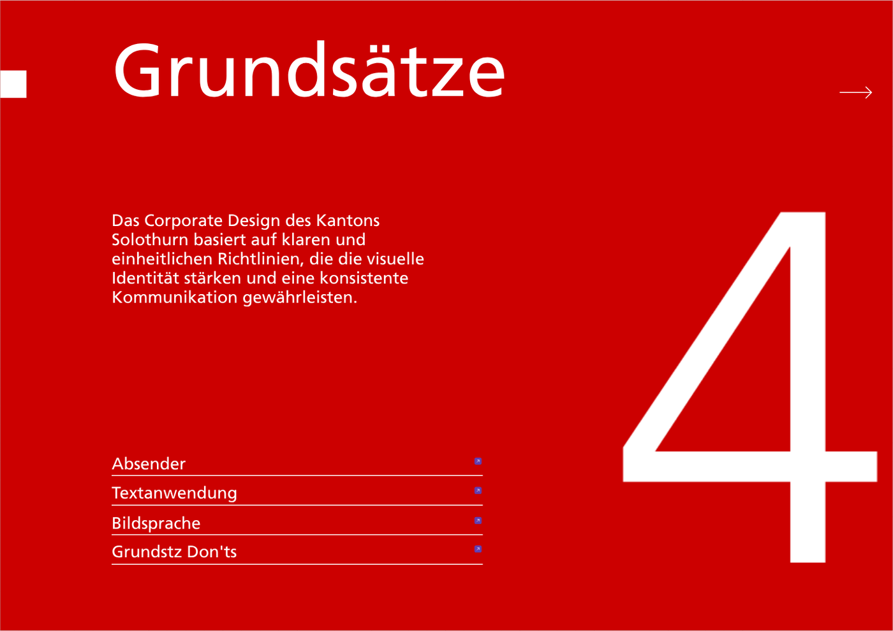

Das Corporate Design des Kantons Solothurn basiert auf klaren und einheitlichen Richtlinien, die die visuelle Identität stärken und eine konsistente Kommunikation gewährleisten.

Unterseiten:

- [Absender](#absender)
- [Textanwendung](#textanwendung)
- [Bildsprache](#bildsprache)
- [Grundstz Don'ts](#grundsätze-donts)

*Abbildung:* Rote Seite mit grosser weisser Ziffer «4».

### Absender

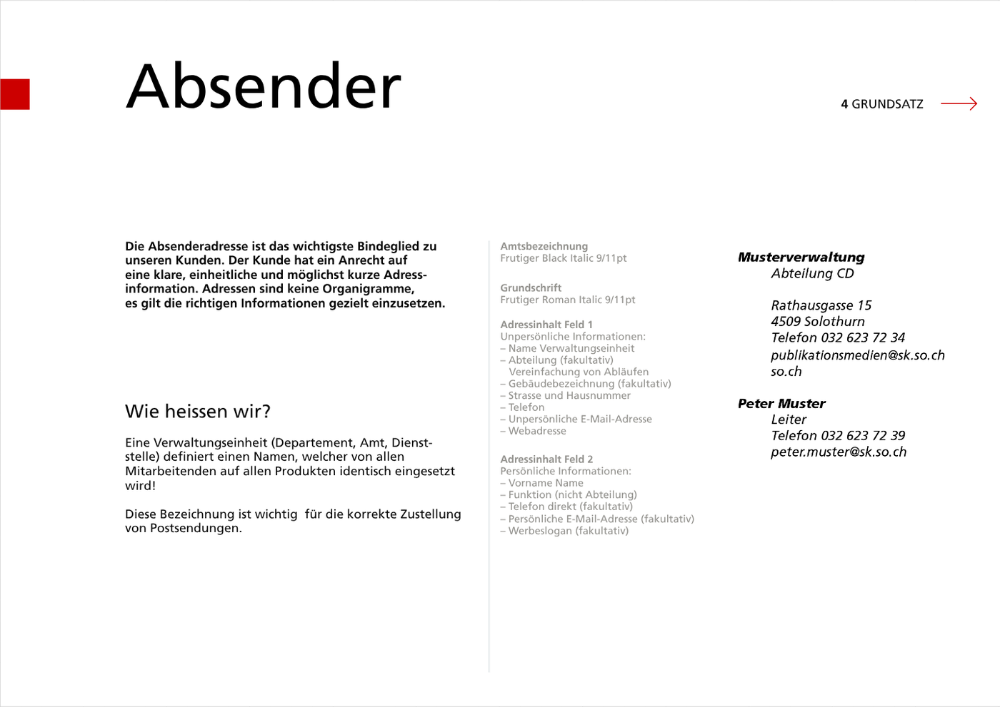

**Die Absenderadresse ist das wichtigste Bindeglied zu unseren Kunden. Der Kunde hat ein Anrecht auf eine klare, einheitliche und möglichst kurze Adressinformation. Adressen sind keine Organigramme, es gilt die richtigen Informationen gezielt einzusetzen.**

**Wie heissen wir?**

Eine Verwaltungseinheit (Departement, Amt, Dienststelle) definiert einen Namen, welcher von allen Mitarbeitenden auf allen Produkten identisch eingesetzt wird!

Diese Bezeichnung ist wichtig  für die korrekte Zustellung von Postsendungen.

**Spezifikationen (mittlere Spalte)**

| Element | Schrift |
|---|---|
| Amtsbezeichnung | Frutiger Black Italic 9/11pt |
| Grundschrift | Frutiger Roman Italic 9/11pt |

**Adressinhalt Feld 1**

Unpersönliche Informationen:\
– Name Verwaltungseinheit\
– Abteilung (fakultativ)\
  Vereinfachung von Abläufen\
– Gebäudebezeichnung (fakultativ)\
– Strasse und Hausnummer\
– Telefon\
– Unpersönliche E-Mail-Adresse\
– Webadresse

**Adressinhalt Feld 2**

Persönliche Informationen:\
– Vorname Name\
– Funktion (nicht Abteilung)\
– Telefon direkt (fakultativ)\
– Persönliche E-Mail-Adresse (fakultativ)\
– Werbeslogan (fakultativ)

*Abbildung (Musteradresse, rechte Spalte; Namen in Black Italic, Angaben in Italic eingerückt):*

***Musterverwaltung***\
  *Abteilung CD*

  *Rathausgasse 15*\
  *4509 Solothurn*\
  *Telefon 032 623 72 34*\
  *publikationsmedien@sk.so.ch*\
  *so.ch*

***Peter Muster***\
  *Leiter*\
  *Telefon 032 623 72 39*\
  *peter.muster@sk.so.ch*

### Textanwendung

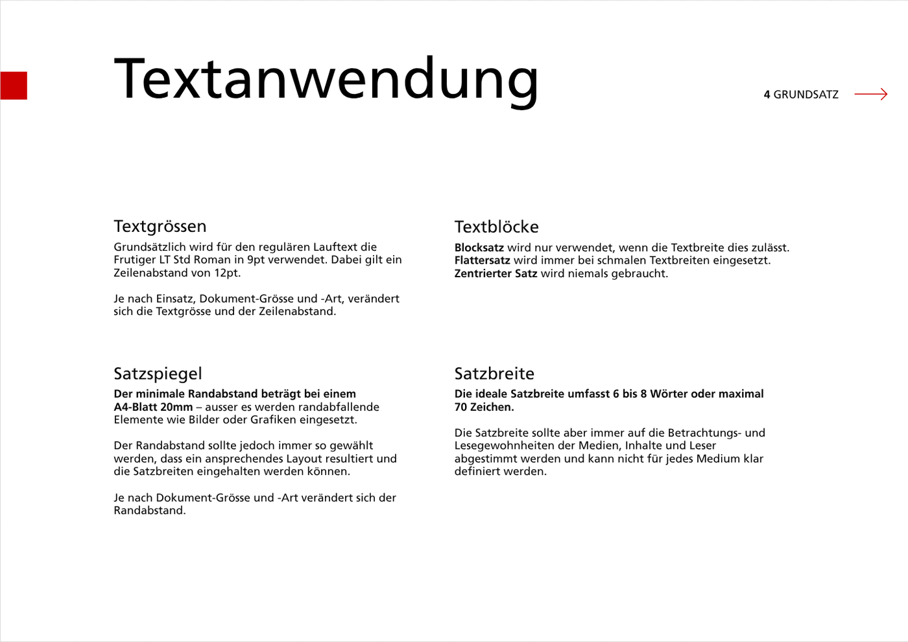

**Textgrössen**

Grundsätzlich wird für den regulären Lauftext die Frutiger LT Std Roman in 9pt verwendet. Dabei gilt ein Zeilenabstand von 12pt.

Je nach Einsatz, Dokument-Grösse und -Art, verändert sich die Textgrösse und der Zeilenabstand.

**Textblöcke**

**Blocksatz** wird nur verwendet, wenn die Textbreite dies zulässt.\
**Flattersatz** wird immer bei schmalen Textbreiten eingesetzt.\
**Zentrierter Satz** wird niemals gebraucht.

**Satzspiegel**

**Der minimale Randabstand beträgt bei einem A4-Blatt 20mm** – ausser es werden randabfallende Elemente wie Bilder oder Grafiken eingesetzt.

Der Randabstand sollte jedoch immer so gewählt werden, dass ein ansprechendes Layout resultiert und die Satzbreiten eingehalten werden können.

Je nach Dokument-Grösse und -Art verändert sich der Randabstand.

**Satzbreite**

**Die ideale Satzbreite umfasst 6 bis 8 Wörter oder maximal 70 Zeichen.**

Die Satzbreite sollte aber immer auf die Betrachtungs- und Lesegewohnheiten der Medien, Inhalte und Leser abgestimmt werden und kann nicht für jedes Medium klar definiert werden.

### Bildsprache

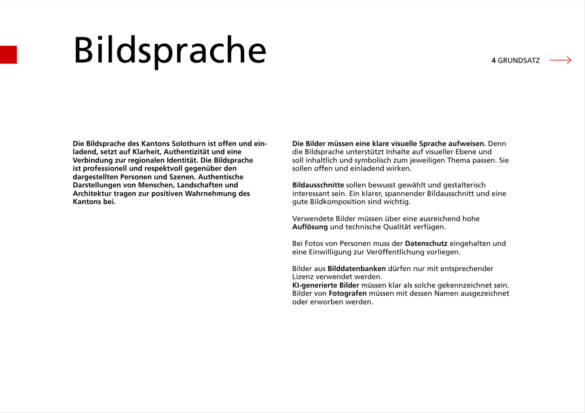

**Die Bildsprache des Kantons Solothurn ist offen und einladend, setzt auf Klarheit, Authentizität und eine Verbindung zur regionalen Identität. Die Bildsprache ist professionell und respektvoll gegenüber den dargestellten Personen und Szenen. Authentische Darstellungen von Menschen, Landschaften und Architektur tragen zur positiven Wahrnehmung des Kantons bei.**

**Die Bilder müssen eine klare visuelle Sprache aufweisen.** Denn die Bildsprache unterstützt Inhalte auf visueller Ebene und soll inhaltlich und symbolisch zum jeweiligen Thema passen. Sie sollen offen und einladend wirken.

**Bildausschnitte** sollen bewusst gewählt und gestalterisch interessant sein. Ein klarer, spannender Bildausschnitt und eine gute Bildkomposition sind wichtig.

Verwendete Bilder müssen über eine ausreichend hohe **Auflösung** und technische Qualität verfügen.

Bei Fotos von Personen muss der **Datenschutz** eingehalten und eine Einwilligung zur Veröffentlichung vorliegen.

Bilder aus **Bilddatenbanken** dürfen nur mit entsprechender Lizenz verwendet werden.\
**KI-generierte Bilder** müssen klar als solche gekennzeichnet sein.\
Bilder von **Fotografen** müssen mit dessen Namen ausgezeichnet oder erworben werden.

### Grundsätze Don'ts

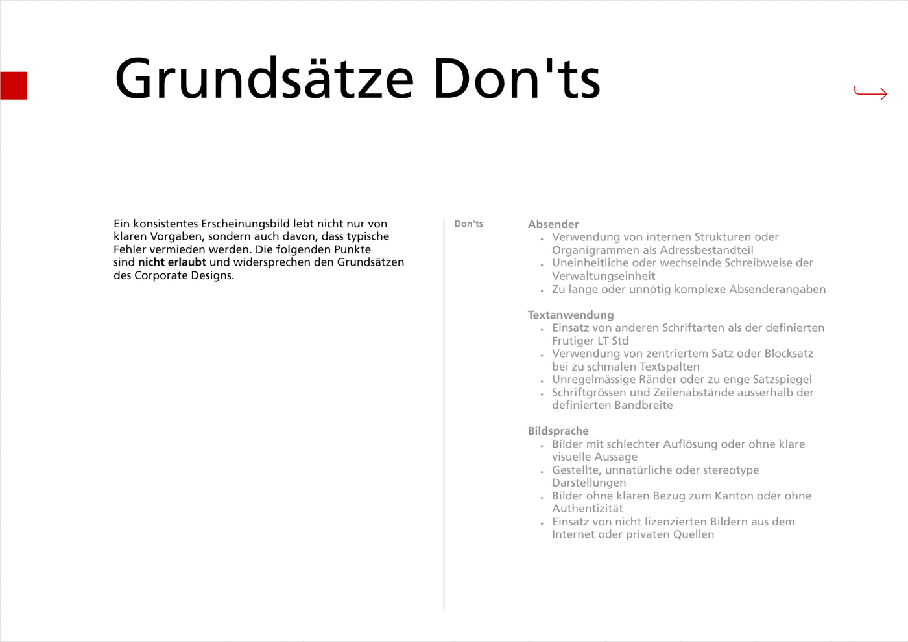

Ein konsistentes Erscheinungsbild lebt nicht nur von klaren Vorgaben, sondern auch davon, dass typische Fehler vermieden werden. Die folgenden Punkte sind **nicht erlaubt** und widersprechen den Grundsätzen des Corporate Designs.

**Don'ts**

**Absender**

- Verwendung von internen Strukturen oder Organigrammen als Adressbestandteil
- Uneinheitliche oder wechselnde Schreibweise der Verwaltungseinheit
- Zu lange oder unnötig komplexe Absenderangaben

**Textanwendung**

- Einsatz von anderen Schriftarten als der definierten Frutiger LT Std
- Verwendung von zentriertem Satz oder Blocksatz bei zu schmalen Textspalten
- Unregelmässige Ränder oder zu enge Satzspiegel
- Schriftgrössen und Zeilenabstände ausserhalb der definierten Bandbreite

**Bildsprache**

- Bilder mit schlechter Auflösung oder ohne klare visuelle Aussage
- Gestellte, unnatürliche oder stereotype Darstellungen
- Bilder ohne klaren Bezug zum Kanton oder ohne Authentizität
- Einsatz von nicht lizenzierten Bildern aus dem Internet oder privaten Quellen

(Im Original als Punkt-Aufzählung «•» gesetzt.)

## 5 Anwendung

### Anwendung – Kapitelübersicht

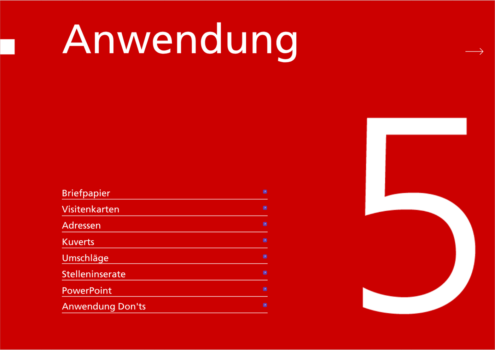

Diese Kapitelseite enthält keinen Einleitungstext.

Unterseiten:

- [Briefpapier](#briefpapier)
- [Visitenkarten](#visitenkarten)
- [Adressen](#adressen)
- [Kuverts](#kuverts)
- [Umschläge](#umschläge)
- [Stelleninserate](#stelleninserate)
- [PowerPoint](#powerpoint)
- [Anwendung Don'ts](#anwendung-donts)

*Abbildung:* Rote Seite mit grosser weisser Ziffer «5». Die Detailseiten Umschlag A4/A5/A6/5 und Stelleninserat Full/Short/Teaser sind über Links auf den Seiten «Umschläge» und «Stelleninserate» erreichbar.

### Briefpapier

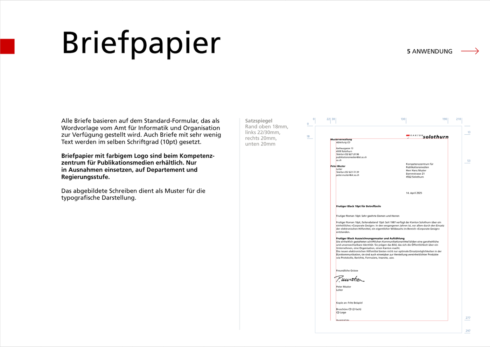

Alle Briefe basieren auf dem Standard-Formular, das als Wordvorlage vom Amt für Informatik und Organisation zur Verfügung gestellt wird. Auch Briefe mit sehr wenig Text werden im selben Schriftgrad (10pt) gesetzt.

**Briefpapier mit farbigem Logo sind beim Kompetenzzentrum für Publikationsmedien erhältlich. Nur in Ausnahmen einsetzen, auf Departement und Regierungsstufe.**

Das abgebildete Schreiben dient als Muster für die typografische Darstellung.

**Satzspiegel**

| Rand | Mass |
|---|---|
| oben | 18mm |
| links | 22/30mm |
| rechts | 20mm |
| unten | 20mm |

**Typografische Angaben im Musterbrief**

| Element | Angabe im Muster |
|---|---|
| Betreffzeile | Frutiger Black 10pt |
| Anrede | Frutiger Roman 10pt |
| Brieftext | Frutiger Roman 10pt, Zeilenabstand 13pt |
| Auszeichnung und Aufzählung | Frutiger Black |

*Abbildung:* A4-Musterbrief mit Massraster (Zahlen ohne Einheitenangabe; horizontal 0, 22 | 30, 130, 190, 210; vertikal 0, 18 sowie rechts 13, 53, 277, 297) und rot umrandetem Satzspiegel. Logo «KANTON solothurn» (farbig) oben rechts zwischen 130 und 190; Absender oben links (Namen in Black Italic, Angaben in Italic eingerückt); Empfängeradresse rechts ab 130/53; Datum; Brieftext.

<details>
<summary>Mustertext der Abbildung</summary>

***Musterverwaltung*** / *Abteilung CD* / *Rathausgasse 15* / *4509 Solothurn* / *Telefon 032 627 20 96* / *publikationsmedien@sk.so.ch* / *so.ch*\
***Peter Muster*** / *Leiter* / *Telefon 032 623 72 39* / *peter.muster@sk.so.ch*

Kompetenzzentrum für\
Publikationsmedien\
Herr Hans Muster\
Dammstrasse 21\
4502 Solothurn

14. April 2025

**Frutiger Black 10pt für Betreffzeile**

Frutiger Roman 10pt: Sehr geehrte Damen und Herren

Frutiger Roman 10pt, Zeilenabstand 13pt: Seit 1987 verfügt der Kanton Solothurn über ein einheitliches «Corporate Design». In den vergangenen Jahren ist, vor allem durch den Einsatz der elektronischen Hilfsmittel, ein eigentlicher Wildwuchs im Bereich «Corporate Design» entstanden.

**Frutiger Black Auszeichnungsmuster und Aufzählung**

Die einheitlich gestalteten schriftlichen Kommunikationsmittel bilden eine ganzheitliche und unverwechselbare Identität. Sie prägen das Bild, das sich die Öffentlichkeit über ein Unternehmen, eine Organisation, einen Kanton macht.
Die neuen elektronischen Hilfsmittel bieten nicht nur optimale Einsatzmöglichkeiten in der Bürokommunikation, sie sind auch einsetzbar zur Herstellung vereinheitlichter Produkte wie Protokolle, Berichte, Formulare, Inserate, usw.

Freundliche Grüsse

*(Unterschrift «P. Muster»)*

Peter Muster\
Leiter

Kopie an: Fritz Beispiel

Broschüre CD (2-fach)\
CD Logo

Musterbrief.doc *(Kleinsttext)*

</details>

### Visitenkarten

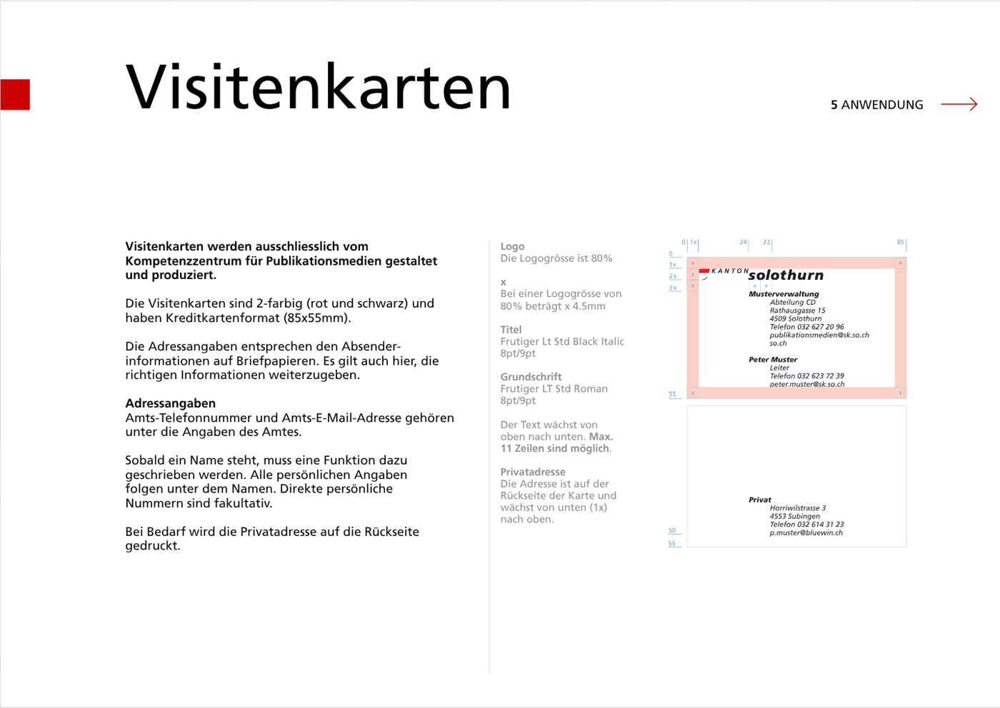

**Visitenkarten werden ausschliesslich vom Kompetenzzentrum für Publikationsmedien gestaltet und produziert.**

Die Visitenkarten sind 2-farbig (rot und schwarz) und haben Kreditkartenformat (85x55mm).

Die Adressangaben entsprechen den Absenderinformationen auf Briefpapieren. Es gilt auch hier, die richtigen Informationen weiterzugeben.

**Adressangaben**

Amts-Telefonnummer und Amts-E-Mail-Adresse gehören unter die Angaben des Amtes.

Sobald ein Name steht, muss eine Funktion dazu geschrieben werden. Alle persönlichen Angaben folgen unter dem Namen. Direkte persönliche Nummern sind fakultativ.

Bei Bedarf wird die Privatadresse auf die Rückseite gedruckt.

**Spezifikationen (rechte Spalte)**

| Element | Angabe |
|---|---|
| Logo | Die Logogrösse ist 80% |
| x | Bei einer Logogrösse von 80% beträgt x 4.5mm |
| Titel | Frutiger Lt Std Black Italic 8pt/9pt |
| Grundschrift | Frutiger LT Std Roman 8pt/9pt |
| Textfluss | Der Text wächst von oben nach unten. **Max. 11 Zeilen sind möglich**. |
| Privatadresse | Die Adresse ist auf der Rückseite der Karte und wächst von unten (1x) nach oben. |

*Abbildung:* Vorder- und Rückseite einer Musterkarte mit Massraster (horizontal 0, 1x, 24, 33, 85; vertikal 0, 1x, 2x, 3x, 55; Rückseite 50, 55); der Randbereich von 1x ist rosa markiert.\
Vorderseite: Logo «KANTON solothurn»; «**Musterverwaltung** / Abteilung CD / Rathausgasse 15 / 4509 Solothurn / Telefon 032 627 20 96 / publikationsmedien@sk.so.ch / so.ch»; «**Peter Muster** / Leiter / Telefon 032 623 72 39 / peter.muster@sk.so.ch».\
Rückseite: «**Privat** / Horriwilstrasse 3 / 4553 Subingen / Telefon 032 614 31 23 / p.muster@bluewin.ch».

### Adressen

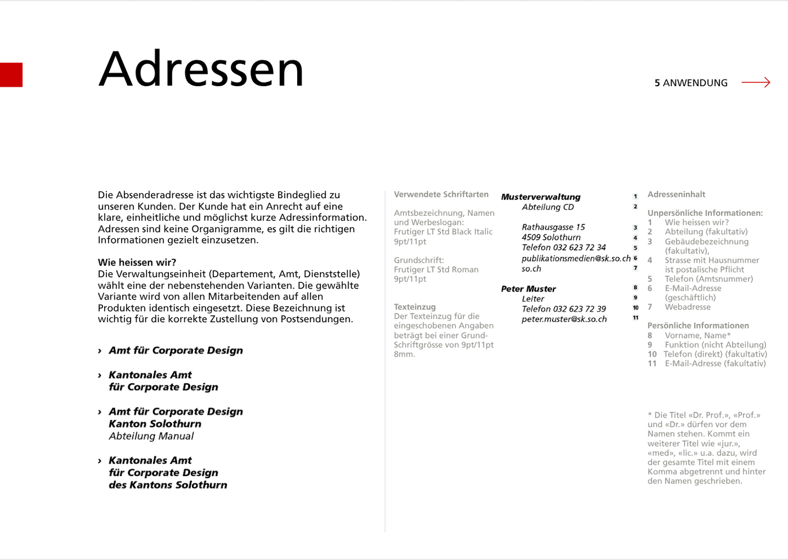

Die Absenderadresse ist das wichtigste Bindeglied zu unseren Kunden. Der Kunde hat ein Anrecht auf eine klare, einheitliche und möglichst kurze Adressinformation. Adressen sind keine Organigramme, es gilt die richtigen Informationen gezielt einzusetzen.

**Wie heissen wir?**

Die Verwaltungseinheit (Departement, Amt, Dienststelle) wählt eine der nebenstehenden Varianten. Die gewählte Variante wird von allen Mitarbeitenden auf allen Produkten identisch eingesetzt. Diese Bezeichnung ist wichtig für die korrekte Zustellung von Postsendungen.

- ***Amt für Corporate Design***
- ***Kantonales Amt***<br>***für Corporate Design***
- ***Amt für Corporate Design***<br>***Kanton Solothurn***<br>*Abteilung Manual*
- ***Kantonales Amt***<br>***für Corporate Design***<br>***des Kantons Solothurn***

**Verwendete Schriftarten**

| Verwendung | Schrift |
|---|---|
| Amtsbezeichnung, Namen und Werbeslogan | Frutiger LT Std Black Italic 9pt/11pt |
| Grundschrift | Frutiger LT Std Roman 9pt/11pt |

**Texteinzug**

Der Texteinzug für die eingeschobenen Angaben beträgt bei einer Grundschriftgrösse von 9pt/11pt 8mm.

*Abbildung (Musteradresse mit Nummern 1–11):*

| Nr. | Musterzeile |
|---|---|
| 1 | ***Musterverwaltung*** |
| 2 | *Abteilung CD* |
| 3 | *Rathausgasse 15* |
| 4 | *4509 Solothurn* |
| 5 | *Telefon 032 623 72 34* |
| 6 | *publikationsmedien@sk.so.ch* |
| 7 | *so.ch* |
| 8 | ***Peter Muster*** |
| 9 | *Leiter* |
| 10 | *Telefon 032 623 72 39* |
| 11 | *peter.muster@sk.so.ch* |

**Adresseninhalt**

*Unpersönliche Informationen:*

1. Wie heissen wir?
2. Abteilung (fakultativ)
3. Gebäudebezeichnung (fakultativ),
4. Strasse mit Hausnummer ist postalische Pflicht
5. Telefon (Amtsnummer)
6. E-Mail-Adresse (geschäftlich)
7. Webadresse

*Persönliche Informationen*

8. Vorname, Name*
9. Funktion (nicht Abteilung)
10. Telefon (direkt) (fakultativ)
11. E-Mail-Adresse (fakultativ)

\* Die Titel «Dr. Prof.», «Prof.» und «Dr.» dürfen vor dem Namen stehen. Kommt ein weiterer Titel wie «jur.», «med», «lic.» u.a. dazu, wird der gesamte Titel mit einem Komma abgetrennt und hinter den Namen geschrieben.

### Kuverts

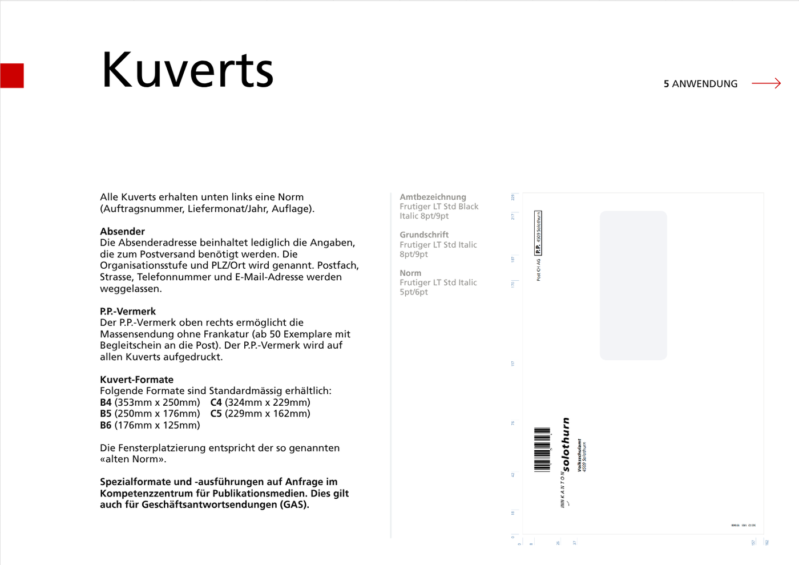

Alle Kuverts erhalten unten links eine Norm (Auftragsnummer, Liefermonat/Jahr, Auflage).

**Absender**

Die Absenderadresse beinhaltet lediglich die Angaben, die zum Postversand benötigt werden. Die Organisationsstufe und PLZ/Ort wird genannt. Postfach, Strasse, Telefonnummer und E-Mail-Adresse werden weggelassen.

**P.P.-Vermerk**

Der P.P.-Vermerk oben rechts ermöglicht die Massensendung ohne Frankatur (ab 50 Exemplare mit Begleitschein an die Post). Der P.P.-Vermerk wird auf allen Kuverts aufgedruckt.

**Kuvert-Formate**

Folgende Formate sind Standardmässig erhältlich:

| Format | Masse |
|---|---|
| **B4** | 353mm x 250mm |
| **C4** | 324mm x 229mm |
| **B5** | 250mm x 176mm |
| **C5** | 229mm x 162mm |
| **B6** | 176mm x 125mm |

Die Fensterplatzierung entspricht der so genannten «alten Norm».

**Spezialformate und -ausführungen auf Anfrage im Kompetenzzentrum für Publikationsmedien. Dies gilt auch für Geschäftsantwortsendungen (GAS).**

**Spezifikationen (rechte Spalte)**

| Element | Schrift |
|---|---|
| Amtbezeichnung | Frutiger LT Std Black Italic 8pt/9pt |
| Grundschrift | Frutiger LT Std Italic 8pt/9pt |
| Norm | Frutiger LT Std Italic 5pt/6pt |

*Abbildung:* Musterkuvert (Aussenmasse laut Massraster 229 × 162, entspricht dem oben genannten Format C5), im Board um 90° gedreht dargestellt, mit Massraster (Längsseite 0, 18, 42, 76, 117, 170, 187, 217, 229; Schmalseite 0, 8, 26, 37, 157, 162). Oben links Strichcode, Logo «KANTON solothurn» und Absender «***Volksschulamt*** / *4509 Solothurn*»; oben rechts «Post CH AG | **P.P.** 4509 Solothurn» (umrandet); rechts das Adressfenster; unten links die Norm (Kleinsttext [unleserlich]).

### Umschläge

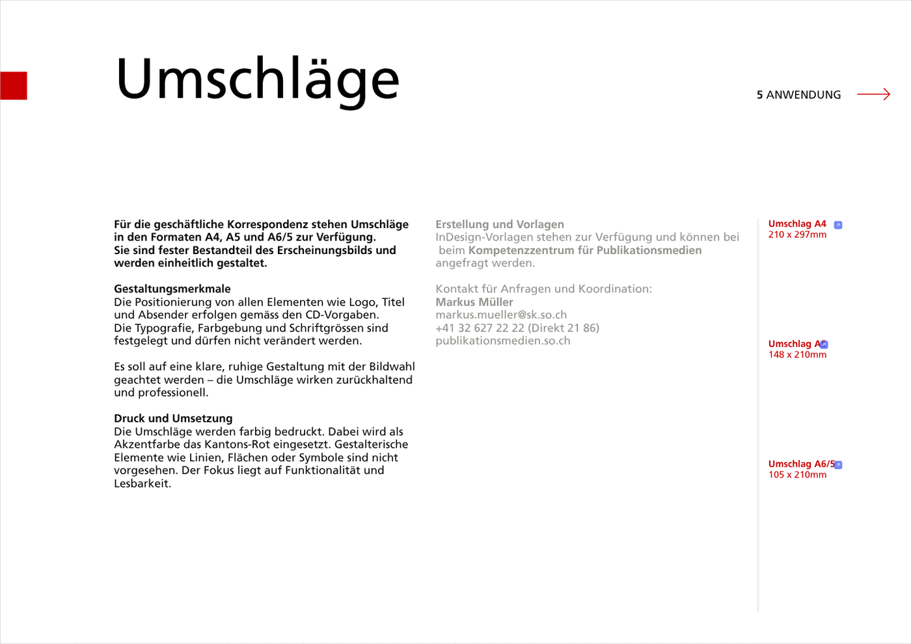

**Für die geschäftliche Korrespondenz stehen Umschläge in den Formaten A4, A5 und A6/5 zur Verfügung. Sie sind fester Bestandteil des Erscheinungsbilds und werden einheitlich gestaltet.**

**Gestaltungsmerkmale**

Die Positionierung von allen Elementen wie Logo, Titel und Absender erfolgen gemäss den CD-Vorgaben.
Die Typografie, Farbgebung und Schriftgrössen sind festgelegt und dürfen nicht verändert werden.

Es soll auf eine klare, ruhige Gestaltung mit der Bildwahl geachtet werden – die Umschläge wirken zurückhaltend und professionell.

**Druck und Umsetzung**

Die Umschläge werden farbig bedruckt. Dabei wird als Akzentfarbe das Kantons-Rot eingesetzt. Gestalterische Elemente wie Linien, Flächen oder Symbole sind nicht vorgesehen. Der Fokus liegt auf Funktionalität und Lesbarkeit.

**Erstellung und Vorlagen**

InDesign-Vorlagen stehen zur Verfügung und können bei  beim **Kompetenzzentrum für Publikationsmedien** angefragt werden.

Kontakt für Anfragen und Koordination:\
**Markus Müller**\
markus.mueller@sk.so.ch\
+41 32 627 22 22 (Direkt 21 86)\
publikationsmedien.so.ch

**Formate (rechte Spalte, jeweils mit Link-Symbol auf die Detailseite)**

| Umschlag | Format |
|---|---|
| Umschlag A4 | 210 x 297mm |
| Umschlag A5 | 148 x 210mm |
| Umschlag A6/5 | 105 x 210mm |

### Umschlag | A4

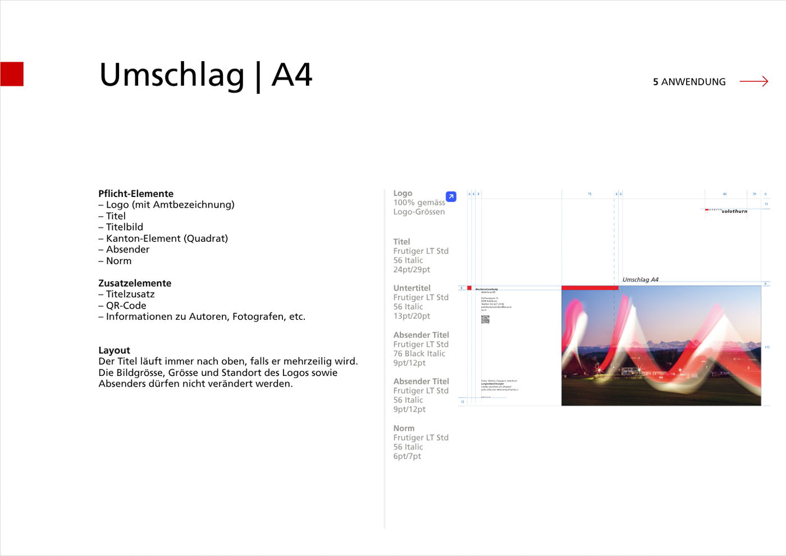

**Pflicht-Elemente**

– Logo (mit Amtbezeichnung)\
– Titel\
– Titelbild\
– Kanton-Element (Quadrat)\
– Absender\
– Norm

**Zusatzelemente**

– Titelzusatz\
– QR-Code\
– Informationen zu Autoren, Fotografen, etc.

**Layout**

Der Titel läuft immer nach oben, falls er mehrzeilig wird.
Die Bildgrösse, Grösse und Standort des Logos sowie Absenders dürfen nicht verändert werden.

**Spezifikationen (rechte Spalte)**

| Element | Angabe |
|---|---|
| Logo | 100% gemäss Logo-Grössen (Link) |
| Titel | Frutiger LT Std 56 Italic 24pt/29pt |
| Untertitel | Frutiger LT Std 56 Italic 13pt/20pt |
| Absender Titel | Frutiger LT Std 76 Black Italic 9pt/12pt |
| Absender Titel | Frutiger LT Std 56 Italic 9pt/12pt |
| Norm | Frutiger LT Std 56 Italic 6pt/7pt |

*Abbildung:* Aufgeklappter Umschlag mit Massraster (Zahlen ohne Einheitenangabe; oben 6 | 6 | 8 · 75 · 6 | 6 · 60 · 20 · 0; rechts 15, 6, 172; links 6, 12). Vorderseite (rechts): Logo oben rechts, Titel «Umschlag A4», darunter rotes Balkenelement an der Bildoberkante und Titelbild (rot-weisse Lichtspuren vor einem Alpenpanorama in der Dämmerung). Rückseite (links): rotes Quadrat (Kanton-Element), Absender «Musterverwaltung …», QR-Code, unten Bildnachweis und Norm (Kleinsttext [unleserlich]).

### Umschlag | A5

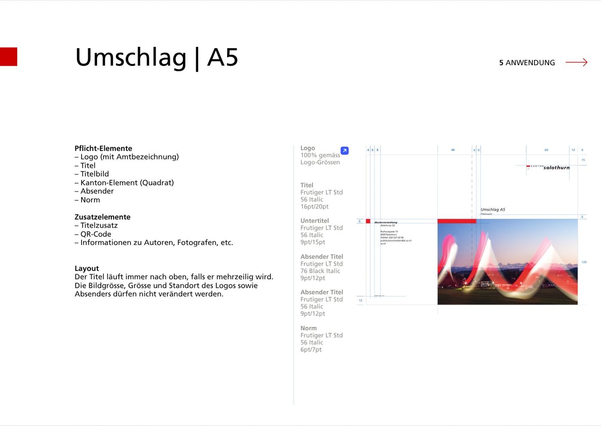

**Pflicht-Elemente**

– Logo (mit Amtbezeichnung)\
– Titel\
– Titelbild\
– Kanton-Element (Quadrat)\
– Absender\
– Norm

**Zusatzelemente**

– Titelzusatz\
– QR-Code\
– Informationen zu Autoren, Fotografen, etc.

**Layout**

Der Titel läuft immer nach oben, falls er mehrzeilig wird.
Die Bildgrösse, Grösse und Standort des Logos sowie Absenders dürfen nicht verändert werden.

**Spezifikationen (rechte Spalte)**

| Element | Angabe |
|---|---|
| Logo | 100% gemäss Logo-Grössen (Link) |
| Titel | Frutiger LT Std 56 Italic 16pt/20pt |
| Untertitel | Frutiger LT Std 56 Italic 9pt/15pt |
| Absender Titel | Frutiger LT Std 76 Black Italic 9pt/12pt |
| Absender Titel | Frutiger LT Std 56 Italic 9pt/12pt |
| Norm | Frutiger LT Std 56 Italic 6pt/7pt |

*Abbildung:* Aufgeklappter Umschlag mit Massraster (Zahlen ohne Einheitenangabe; oben 6 | 6 | 8 · 48 · 6 | 6 · 60 · 12 · 0; rechts 15, 6, 120; links 6, 12). Vorderseite: Logo oben rechts, Titel «Umschlag A5» mit «Titelzusatz», rotes Balkenelement und Titelbild (Lichtspuren vor Alpenpanorama). Rückseite: rotes Quadrat und Absender «***Musterverwaltung*** / *Abteilung CD* / *Rathausgasse 15* / *4509 Solothurn* / *Telefon 032 627 20 96* / *publikationsmedien@sk.so.ch* / *so.ch*», unten Norm (Kleinsttext [unleserlich]).

### Umschlag | A6/5

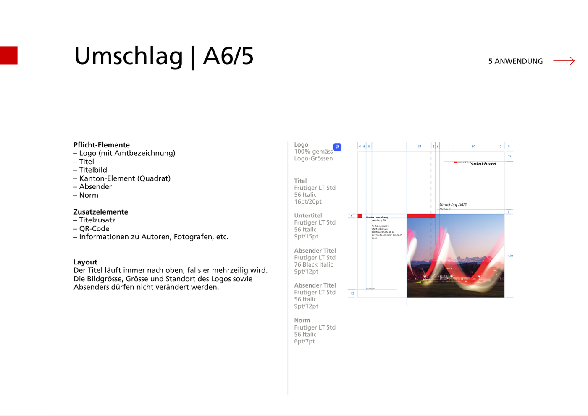

**Pflicht-Elemente**

– Logo (mit Amtbezeichnung)\
– Titel\
– Titelbild\
– Kanton-Element (Quadrat)\
– Absender\
– Norm

**Zusatzelemente**

– Titelzusatz\
– QR-Code\
– Informationen zu Autoren, Fotografen, etc.

**Layout**

Der Titel läuft immer nach oben, falls er mehrzeilig wird.
Die Bildgrösse, Grösse und Standort des Logos sowie Absenders dürfen nicht verändert werden.

**Spezifikationen (rechte Spalte)**

| Element | Angabe |
|---|---|
| Logo | 100% gemäss Logo-Grössen (Link) |
| Titel | Frutiger LT Std 56 Italic 16pt/20pt |
| Untertitel | Frutiger LT Std 56 Italic 9pt/15pt |
| Absender Titel | Frutiger LT Std 76 Black Italic 9pt/12pt |
| Absender Titel | Frutiger LT Std 56 Italic 9pt/12pt |
| Norm | Frutiger LT Std 56 Italic 6pt/7pt |

*Abbildung:* Aufgeklappter Umschlag mit Massraster (Zahlen ohne Einheitenangabe; oben 6 | 6 | 8 · 35 · 6 | 6 · 60 · 12 · 0; rechts 15, 6, 120; links 6, 12). Vorderseite: Logo oben rechts, Titel «Umschlag A6/5» mit «Titelzusatz», rotes Balkenelement und Titelbild (Lichtspuren vor Alpenpanorama). Rückseite: rotes Quadrat und Absender «Musterverwaltung …», unten Norm (Kleinsttext [unleserlich]).

### Stelleninserate

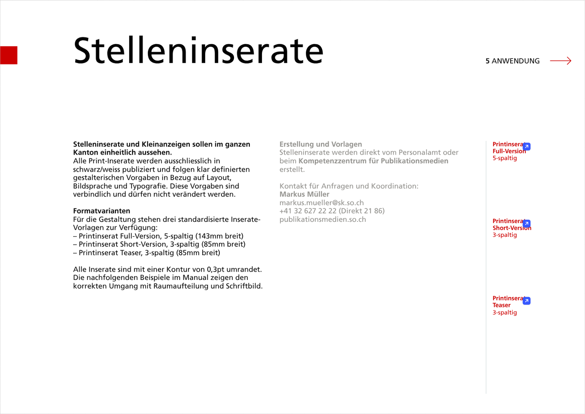

**Stelleninserate und Kleinanzeigen sollen im ganzen Kanton einheitlich aussehen.**

Alle Print-Inserate werden ausschliesslich in schwarz/weiss publiziert und folgen klar definierten gestalterischen Vorgaben in Bezug auf Layout, Bildsprache und Typografie. Diese Vorgaben sind verbindlich und dürfen nicht verändert werden.

**Formatvarianten**

Für die Gestaltung stehen drei standardisierte Inserate-Vorlagen zur Verfügung:\
– Printinserat Full-Version, 5-spaltig (143mm breit)\
– Printinserat Short-Version, 3-spaltig (85mm breit)\
– Printinserat Teaser, 3-spaltig (85mm breit)

Alle Inserate sind mit einer Kontur von 0,3pt umrandet. Die nachfolgenden Beispiele im Manual zeigen den korrekten Umgang mit Raumaufteilung und Schriftbild.

**Erstellung und Vorlagen**

Stelleninserate werden direkt vom Personalamt oder beim **Kompetenzzentrum für Publikationsmedien** erstellt.

Kontakt für Anfragen und Koordination:\
**Markus Müller**\
markus.mueller@sk.so.ch\
+41 32 627 22 22 (Direkt 21 86)\
publikationsmedien.so.ch

**Varianten (rechte Spalte, jeweils mit Link-Symbol auf die Detailseite)**

| Variante | Spalten |
|---|---|
| Printinserat Full-Version | 5-spaltig |
| Printinserat Short-Version | 3-spaltig |
| Printinserat Teaser | 3-spaltig |

### Stelleninserat | Full

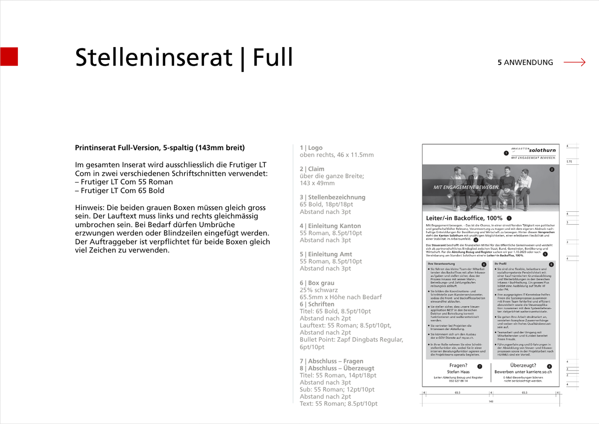

**Printinserat Full-Version, 5-spaltig (143mm breit)**

Im gesamten Inserat wird ausschliesslich die Frutiger LT Com in zwei verschiedenen Schriftschnitten verwendet:\
– Frutiger LT Com 55 Roman\
– Frutiger LT Com 65 Bold

Hinweis: Die beiden grauen Boxen müssen gleich gross sein. Der Lauftext muss links und rechts gleichmässig umbrochen sein. Bei Bedarf dürfen Umbrüche erzwungen werden oder Blindzeilen eingefügt werden. Der Auftraggeber ist verpflichtet für beide Boxen gleich viel Zeichen zu verwenden.

**Spezifikationen (rechte Spalte)**

| Nr. | Element | Angabe |
|---|---|---|
| 1 | Logo | oben rechts, 46 x 11.5mm |
| 2 | Claim | über die ganze Breite; 143 x 49mm |
| 3 | Stellenbezeichnung | 65 Bold, 18pt/18pt; Abstand nach 3pt |
| 4 | Einleitung Kanton | 55 Roman, 8.5pt/10pt; Abstand nach 3pt |
| 5 | Einleitung Amt | 55 Roman, 8.5pt/10pt; Abstand nach 3pt |
| 6 | Box grau | 25% schwarz; 65.5mm x Höhe nach Bedarf |
| 6 | Schriften | Titel: 65 Bold, 8.5pt/10pt; Abstand nach 2pt<br>Lauftext: 55 Roman; 8.5pt/10pt, Abstand nach 2pt<br>Bullet Point: Zapf Dingbats Regular, 6pt/10pt |
| 7 / 8 | Abschluss – Fragen / Abschluss – Überzeugt | Titel: 55 Roman, 14pt/18pt; Abstand nach 3pt<br>Sub: 55 Roman; 12pt/10pt; Abstand nach 2pt<br>Text: 55 Roman; 8.5pt/10pt |

*Abbildung:* Musterinserat in Graustufen, 143 mm breit (Masslinie 4 | 65.5 | 4 | 65.5 | 4; vertikale Abstände 4, 5.75, 4, 3, 3, 4, 4, 3, 2, 4), Positionen 1–8 nummeriert: Logo mit Claimzeile «MIT ENGAGEMENT BEWEGEN.» oben rechts (1), Claimbild mit fünf Personen auf einer Bank und Schriftzug «MIT ENGAGEMENT BEWEGEN.» (2), Stellenbezeichnung «Leiter/-in Backoffice, 100%» (3), zwei Einleitungsabsätze (4, 5), zwei graue Boxen «Ihre Verantwortung» und «Ihr Profil» (6), Abschluss «Fragen?» (7) und «Überzeugt?» (8).

<details>
<summary>Mustertext der Abbildung</summary>

**Leiter/-in Backoffice, 100%**

Mit Engagement bewegen. – Das ist die Chance, in einer sinnstiftenden Tätigkeit von politischer und gesellschaftlicher Relevanz, Verantwortung zu tragen und mit dem eigenen Abdruck nachhaltige Entwicklungen für Bevölkerung und Wirtschaft zu bewegen. Hinter diesem **Versprechen** steht der **Kanton Solothurn** mit unzähligen Möglichkeiten, einer erlebbaren Flexibilität und einer Stabilität im Arbeitsumfeld.

Das **Steueramt** beschafft die finanziellen Mittel für das öffentliche Gemeinwesen und versteht sich als partnerschaftliches Bindeglied zwischen Staat, Bund, Gemeinden, Bevölkerung und Wirtschaft. Für die **Abteilung Bezug und Register** suchen wir per 1.10.2023 oder nach Vereinbarung am Standort Solothurn eine/n **Leiter/-in Backoffice, 100%**.

**Ihre Verantwortung**

- Sie führen das kleine Team der Mitarbeitenden des Backoffices mit allen Inkassoaufgaben und stellen sicher, dass der Prozess Inkasso mit seinen Mahn-, Betreibungs- und Zahlungsläufen reibungslos abläuft.
- Sie bilden die Koordinations- und Schnittstelle zum Kundenservicecenter, sodass die Front- und Backofficearbeiten einwandfrei ablaufen.
- Sie stellen sicher, dass unsere Steuerapplikation NEST in den Bereichen Debitor und Betreibung korrekt funktionieren und weiterentwickelt werden.
- Sie vertreten bei Projekten die Interessen der Abteilung.
- Sie kümmern sich um den Ausbau der e-GOV Dienste auf my.so.ch.
- In Ihrer Rolle nehmen Sie eine Schnittstellenfunktion ein, wobei Sie in einer internen Beratungsfunktion agieren und die Projektteams operativ begleiten.

**Ihr Profil**

- Sie sind eine flexible, belastbare und sozialkompetente Persönlichkeit mit einer kaufmännischen Grundausbildung und Weiterbildungen in den Bereichen Inkasso / Buchhaltung. Ein grosses Plus bildet eine Ausbildung auf Stufe HF oder FH.
- Ihre ausgeprägten IT-Kenntnisse helfen Ihnen die Systemprozesse zusammen mit Ihrem Team fehlerfrei und effizient abzuwickeln sowie die Steuerapplikation zusammen mit dem Systemlieferanten zielgerichtet weiterzuentwickeln.
- Sie gehen Ihre Arbeit strukturiert an, verstehen komplexe Zusammenhänge und weisen ein hohes Qualitätsbewusstsein auf.
- Teamarbeit und der Umgang mit Mitarbeitenden und Kunden bereitet Ihnen Freude.
- Führungserfahrung und Erfahrungen in der Abwicklung von Steuer- und Inkassoprozessen sowie in der Projektarbeit nach HERMES sind ein Vorteil.

**Fragen?** Stefan Haas – Leiter Abteilung Bezug und Register – 032 627 88 14\
**Überzeugt?** Bewerben unter karriere.so.ch – E-Mail-Bewerbungen können nicht berücksichtigt werden.

</details>

### Stelleninserat | Short

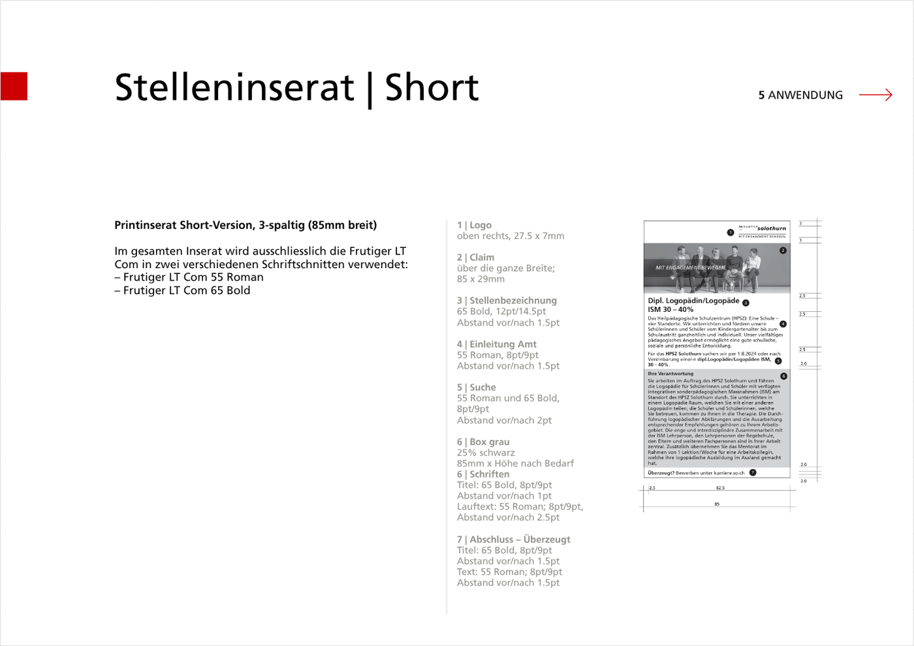

**Printinserat Short-Version, 3-spaltig (85mm breit)**

Im gesamten Inserat wird ausschliesslich die Frutiger LT Com in zwei verschiedenen Schriftschnitten verwendet:\
– Frutiger LT Com 55 Roman\
– Frutiger LT Com 65 Bold

**Spezifikationen (rechte Spalte)**

| Nr. | Element | Angabe |
|---|---|---|
| 1 | Logo | oben rechts, 27.5 x 7mm |
| 2 | Claim | über die ganze Breite; 85 x 29mm |
| 3 | Stellenbezeichnung | 65 Bold, 12pt/14.5pt; Abstand vor/nach 1.5pt |
| 4 | Einleitung Amt | 55 Roman, 8pt/9pt; Abstand vor/nach 1.5pt |
| 5 | Suche | 55 Roman und 65 Bold, 8pt/9pt; Abstand vor/nach 2pt |
| 6 | Box grau | 25% schwarz; 85mm x Höhe nach Bedarf |
| 6 | Schriften | Titel: 65 Bold, 8pt/9pt; Abstand vor/nach 1pt<br>Lauftext: 55 Roman; 8pt/9pt, Abstand vor/nach 2.5pt |
| 7 | Abschluss – Überzeugt | Titel: 65 Bold, 8pt/9pt; Abstand vor/nach 1.5pt<br>Text: 55 Roman; 8pt/9pt; Abstand vor/nach 1.5pt |

*Abbildung:* Musterinserat in Graustufen, 85 mm breit (Masslinie 2.5 | 82.5; vertikale Abstände 3, 3, 2.5, 2.5, 2.5, 2.0, 2.0, 2.0), Positionen 1–7 nummeriert: Logo mit Claimzeile (1), Claimbild «MIT ENGAGEMENT BEWEGEN.» (2), Stellenbezeichnung (3), Einleitung Amt (4), Suche (5), eine graue Box «Ihre Verantwortung» über die ganze Breite (6), Abschlusszeile (7).

<details>
<summary>Mustertext der Abbildung</summary>

**Dipl. Logopädin/Logopäde ISM 30 – 40%**

Das Heilpädagogische Schulzentrum (HPSZ): Eine Schule – vier Standorte. Wir unterrichten und fördern unsere Schülerinnen und Schüler vom Kindergartenalter bis zum Schulaustritt ganzheitlich und individuell. Unser vielfältiges pädagogisches Angebot ermöglicht eine gute schulische, soziale und persönliche Entwicklung.

Für das **HPSZ Solothurn** suchen wir per 1.8.2024 oder nach Vereinbarung eine/-n **dipl.Logopädin/Logopäden ISM, 30 – 40%**.

**Ihre Verantwortung**

Sie arbeiten im Auftrag des HPSZ Solothurn und führen die Logopädie für Schülerinnen und Schüler mit verfügten integrativen sonderpädagogischen Massnahmen (ISM) am Standort des HPSZ Solothurn durch. Sie unterrichten in einem Logopädie Raum, welchen Sie mit einer anderen Logopädin teilen; die Schüler und Schülerinnen, welche Sie betreuen, kommen zu Ihnen in die Therapie. Die Durchführung logopädischer Abklärungen und die Ausarbeitung entsprechender Empfehlungen gehören zu Ihrem Arbeitsgebiet. Die enge und interdisziplinäre Zusammenarbeit mit der ISM Lehrperson, den Lehrpersonen der Regelschule, den Eltern und weiteren Fachpersonen sind in Ihrer Arbeit zentral. Zusätzlich übernehmen Sie das Mentorat im Rahmen von 1 Lektion/Woche für eine Arbeitskollegin, welche ihre logopädische Ausbildung im Ausland gemacht hat.

**Überzeugt?** Bewerben unter karriere.so.ch

</details>

### Stelleninserat | Teaser

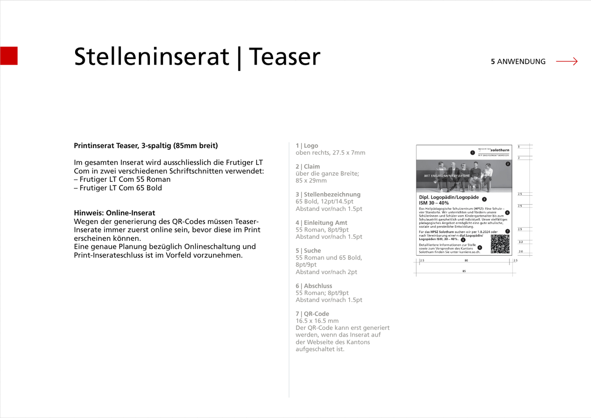

**Printinserat Teaser, 3-spaltig (85mm breit)**

Im gesamten Inserat wird ausschliesslich die Frutiger LT Com in zwei verschiedenen Schriftschnitten verwendet:\
– Frutiger LT Com 55 Roman\
– Frutiger LT Com 65 Bold

**Hinweis: Online-Inserat**

Wegen der generierung des QR-Codes müssen Teaser-Inserate immer zuerst online sein, bevor diese im Print erscheinen können.
Eine genaue Planung bezüglich Onlineschaltung und Print-Inserateschluss ist im Vorfeld vorzunehmen.

**Spezifikationen (rechte Spalte)**

| Nr. | Element | Angabe |
|---|---|---|
| 1 | Logo | oben rechts, 27.5 x 7mm |
| 2 | Claim | über die ganze Breite; 85 x 29mm |
| 3 | Stellenbezeichnung | 65 Bold, 12pt/14.5pt; Abstand vor/nach 1.5pt |
| 4 | Einleitung Amt | 55 Roman, 8pt/9pt; Abstand vor/nach 1.5pt |
| 5 | Suche | 55 Roman und 65 Bold, 8pt/9pt; Abstand vor/nach 2pt |
| 6 | Abschluss | 55 Roman; 8pt/9pt; Abstand vor/nach 1.5pt |
| 7 | QR-Code | 16.5 x 16.5 mm – Der QR-Code kann erst generiert werden, wenn das Inserat auf der Webseite des Kantons aufgeschaltet ist. |

*Abbildung:* Musterinserat in Graustufen, 85 mm breit (Masslinie 2.5 | 80 | 2.5; vertikale Abstände 3, 3, 2.5, 2.5, 2.5, 3.3, 2.0), Positionen 1–7 nummeriert: Logo mit Claimzeile (1), Claimbild (2), Stellenbezeichnung (3), Einleitung Amt (4), Suche (5), Abschluss (6), QR-Code unten rechts (7). Keine graue Box.

<details>
<summary>Mustertext der Abbildung</summary>

**Dipl. Logopädin/Logopäde ISM 30 – 40%**

Das Heilpädagogische Schulzentrum (HPSZ): Eine Schule – vier Standorte. Wir unterrichten und fördern unsere Schülerinnen und Schüler vom Kindergartenalter bis zum Schulaustritt ganzheitlich und individuell. Unser vielfältiges pädagogisches Angebot ermöglicht eine gute schulische, soziale und persönliche Entwicklung.

Für das **HPSZ Solothurn** suchen wir per 1.8.2024 oder nach Vereinbarung eine/-n **dipl.Logopädin/ Logopäden ISM, 30 – 40%**.

Detailliertere Informationen zur Stelle sowie zum Versprechen des Kantons Solothurn finden Sie unter karriere.so.ch.

</details>

### PowerPoint

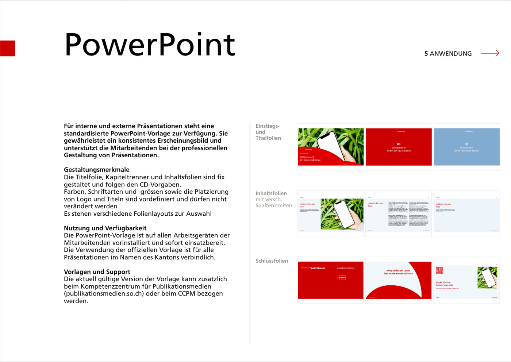

**Für interne und externe Präsentationen steht eine standardisierte PowerPoint-Vorlage zur Verfügung. Sie gewährleistet ein konsistentes Erscheinungsbild und unterstützt die Mitarbeitenden bei der professionellen Gestaltung von Präsentationen.**

**Gestaltungsmerkmale**

Die Titelfolie, Kapiteltrenner und Inhaltsfolien sind fix gestaltet und folgen den CD-Vorgaben.
Farben, Schriftarten und -grössen sowie die Platzierung von Logo und Titeln sind vordefiniert und dürfen nicht verändert werden.
Es stehen verschiedene Folienlayouts zur Auswahl

**Nutzung und Verfügbarkeit**

Die PowerPoint-Vorlage ist auf allen Arbeitsgeräten der Mitarbeitenden vorinstalliert und sofort einsatzbereit.
Die Verwendung der offiziellen Vorlage ist für alle Präsentationen im Namen des Kantons verbindlich.

**Vorlagen und Support**

Die aktuell gültige Version der Vorlage kann zusätzlich beim Kompetenzzentrum für Publikationsmedien (publikationsmedien.so.ch) oder beim CCPM bezogen werden.

**Folienbeispiele (rechte Spalte)**

| Gruppe | Abbildung |
|---|---|
| Einstiegs- und Titelfolien | Einstiegsfolie mit Foto (Hand mit Smartphone vor Gräsern) und roter Bogenform, Text «Willkommen! Ich bin ein Introslide»; Kapiteltrenner auf rotem Grund «01 Willkommen! Ich bin ein neues Kapitel»; derselbe Kapiteltrenner auf hellblauem Grund |
| Inhaltsfolien mit versch. Spaltenbreiten | Drei Inhaltsfolien auf hellgrauem Grund mit rotem Titel «Hallo ich bin ein Titel»: Text mit grossem Bild, Titel mit zwei Textspalten, nur Titel mit kurzem Text |
| Schlussfolien | Rote Folie mit Logo «KANTON solothurn» und «Zusammenfassung» mit Aufzählung; Zitatfolie «Hey ich bin ein Quote Den du dir merken solltest» (in «Guillemets», rote Bogenform); Abschlussfolie mit QR-Code, «Danke für Ihre Aufmerksamkeit» und Foto |

### Anwendung Don'ts

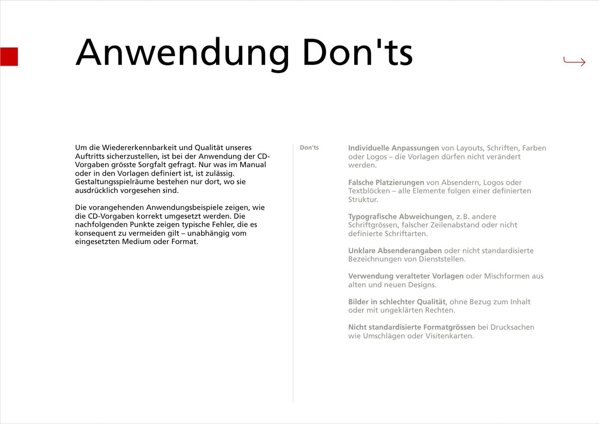

Um die Wiedererkennbarkeit und Qualität unseres Auftritts sicherzustellen, ist bei der Anwendung der CD-Vorgaben grösste Sorgfalt gefragt. Nur was im Manual oder in den Vorlagen definiert ist, ist zulässig. Gestaltungsspielräume bestehen nur dort, wo sie ausdrücklich vorgesehen sind.

Die vorangehenden Anwendungsbeispiele zeigen, wie die CD-Vorgaben korrekt umgesetzt werden. Die nachfolgenden Punkte zeigen typische Fehler, die es konsequent zu vermeiden gilt – unabhängig vom eingesetzten Medium oder Format.

**Don'ts**

- **Individuelle Anpassungen** von Layouts, Schriften, Farben oder Logos – die Vorlagen dürfen nicht verändert werden.
- **Falsche Platzierungen** von Absendern, Logos oder Textblöcken – alle Elemente folgen einer definierten Struktur.
- **Typografische Abweichungen**, z. B. andere Schriftgrössen, falscher Zeilenabstand oder nicht definierte Schriftarten.
- **Unklare Absenderangaben** oder nicht standardisierte Bezeichnungen von Dienststellen.
- **Verwendung veralteter Vorlagen** oder Mischformen aus alten und neuen Designs.
- **Bilder in schlechter Qualität**, ohne Bezug zum Inhalt oder mit ungeklärten Rechten.
- **Nicht standardisierte Formatgrössen** bei Drucksachen wie Umschlägen oder Visitenkarten.

## Kurzreferenz für digitale Anwendungen

Diese Kurzreferenz fasst ausschliesslich Aussagen des Manuals zusammen, die für Bildschirm- und Web-Anwendungen relevant sind; es kommen keine eigenen Gestaltungsempfehlungen hinzu. Die Hex-Werte sind aus den angegebenen RGB-Werten berechnet. Seitenangaben = Frame-Nummer.

### Farbwerte und Farb-Don'ts

**Hauptfarben** (S. 31)

| Farbe | RGB (Manual) | Hex (berechnet) | Weitere Angaben im Manual |
|---|---|---|---|
| Solothurner Rot | 204 \| 0 \| 0 | `#CC0000` | Pantone Rot 032 C oder U; Skala 0 \| 100 \| 100 \| 0 |
| Schwarz | 0 \| 0 \| 0 | `#000000` | Skala 0 \| 0 \| 0 \| 100 |
| Weiss | 255 \| 255 \| 255 | `#FFFFFF` | Skala 0 \| 0 \| 0 \| 0 |

**Farben für Grafiken** (S. 32)

| Gruppe | Name (Schreibweise des Manuals) | RGB (Manual) | Hex (berechnet) |
|---|---|---|---|
| Hauptfarbe | Grau | 100 \| 107 \| 118 | `#646B76` |
| Hauptfarbe | Rot | 204 \| 0 \| 0 | `#CC0000` |
| Hauptfarbe | Schwarz | 51 \| 51 \| 51 | `#333333` |
| Zusatzfarbe | DogerBlue4 | 16 \| 78 \| 139 | `#104E8B` |
| Zusatzfarbe | DeepSkyBlue 2 | 0 \| 178 \| 238 | `#00B2EE` |
| Zusatzfarbe | DarkOrange 1 | 225 \| 140 \| 0 | `#E18C00` ¹ |
| Zusatzfarbe | Gold | 225 \| 215 \| 0 | `#E1D700` ¹ |
| Zusatzfarbe | ForestGreen | 34 \| 139 \| 34 | `#228B22` |
| Zusatzfarbe | YellowGreen | 154 \| 205 \| 50 | `#9ACD32` |

¹ Anmerkung zur Transkription: Beschriftet sind beide Felder mit «R 225». Die Farbflächen selbst sind im Board aber mit R 255 dargestellt (`#FF8C00` bzw. `#FFD700`). Welcher Wert gilt, sagt das Manual nicht.

Anmerkung zur Transkription: «Schwarz» hat auf S. 31 RGB 0 | 0 | 0, bei den Farben für Grafiken (S. 32) RGB 51 | 51 | 51.

**Farb-Don'ts**

- Keine willkürliche Farbwahl (S. 33)
- Keine Farben, die nicht Teil der festgelegten Farbpalette sind (S. 33)
- Keine Farben, die mit anderen Marken, Institutionen oder politischen Parteien in Verbindung stehen (S. 33)
- Keine Farbverläufe oder Schattierungen (S. 33)
- Keine individuellen Anpassungen von Farben; die Vorlagen dürfen nicht verändert werden (S. 64)

### Schriftfamilie und Schnitte

- Schriftfamilie: **Frutiger LT Std**; sie muss lizenzgerecht erworben und installiert werden (S. 21).
- Hauptschnitte (Anwendungen in Microsoft Office): 55 Roman, 56 Italic, 75 Black, 76 Black Italic (S. 22).
- Zusatzschnitte, nur für Agenturen und Grafiker: 45 Light, 46 Light Italic, 65 Bold, 66 BoldItalic (S. 23).
- Ausnahme-Zusatzschnitte Condensed (47 Light Condensed, 57 Condensed, 67 Bold Condensed, 77 Black Condensed): nur in platzarmen Situationen wie in Grafiken, nie im Lauftext (S. 23).
- Nicht erlaubt: andere Schriftarten als die definierte Frutiger LT Std (S. 44); typografische Abweichungen wie andere Schriftgrössen, falscher Zeilenabstand oder nicht definierte Schriftarten (S. 64).
- Anmerkung zur Transkription: Für die (Print-)Stelleninserate schreibt das Manual ausschliesslich Frutiger LT Com 55 Roman und 65 Bold vor (S. 60–62), für Bullet Points in der Full-Version Zapf Dingbats Regular (S. 60).

### Anführungszeichen, Striche, Prozent, Auslassungspunkte, Franken

| Regel | Zeichen / Beispiel | Seite |
|---|---|---|
| Deutsch-, französisch- und italienischsprachige Texte: Guillemets | « » | S. 24 |
| Englische Texte: «Gänsefüsschen» (abgebildet und per Tastenkürzel Alt + 0132 / Alt + 0147) | „ “ | S. 24 |
| Anführung innerhalb von Anführungszeichen: jeweils die einfache Form des Zeichens | ‹ › (bzw. ‚ ‘) | S. 24 |
| Aufzählungen mit dem Halbgeviertstrich; er ist länger als der Bindestrich (Divis) | – (Aufzählung) vs. - (Bindestrich) | S. 24 |
| Halbgeviertstrich als «bis»: davor und danach ein 1/8-Geviert; wenn nicht möglich, kein Wortzwischenraum | 5–8 Uhr · 7.–14. Dezember · Montag–Dienstag | S. 25 |
| Halbgeviertstrich als Texteinschub: davor und danach ein ganzer Wortzwischenraum | Es gibt Gedanken – wie dieser – die sind fertig gedacht. | S. 25 |
| Prozentangaben immer mit dem Zeichen %; in Wortkompositionen ausgeschrieben | %, aber «Stellenprozente» | S. 24 |
| Zwischen Zahl und % ein 1/8-Geviert (im Text und in Tabellen); wenn nicht möglich, kein Wortzwischenraum | 7% · Es wurden 100% erzielt. | S. 25 |
| Auslassungspunkte immer als eigenes Zeichen (Tastenkombination), nie drei normale Punkte | … | S. 24 |
| Auslassungspunkte bei nicht abgeschlossenen Wörtern direkt nach dem letzten Buchstaben, bei nicht abgeschlossenen Sätzen mit Leerschlag | Weissenst… · Solothurn und … | S. 25 |
| Frankenbeträge immer in Zahlen; im Lauftext «Franken» ausschreiben, Abkürzung CHF; zwischen Zahl und Währung ein ganzer Wortzwischenraum | 137.00 Franken · CHF 137.00 | S. 25 |

### Textausrichtung

- Blocksatz nur, wenn die Textbreite dies zulässt (S. 42).
- Flattersatz immer bei schmalen Textbreiten (S. 42).
- Zentrierter Satz wird niemals gebraucht (S. 42).
- Nicht erlaubt: zentrierter Satz oder Blocksatz bei zu schmalen Textspalten; unregelmässige Ränder oder zu enge Satzspiegel (S. 44).

### Zeilenlänge (Satzbreite)

- Die ideale Satzbreite umfasst 6 bis 8 Wörter oder maximal 70 Zeichen (S. 42).
- Sie soll immer auf die Betrachtungs- und Lesegewohnheiten der Medien, Inhalte und Leser abgestimmt werden und kann nicht für jedes Medium klar definiert werden (S. 42).

### Logo-Regeln

**Grundregeln**

- Das Logo nur aus den Originaldateien verwenden; Daten gibt es beim Kompetenzzentrum für Publikationsmedien (S. 10).
- Wappen und Schriftzug bilden eine unveränderbare Einheit; die Proportionen dürfen nicht verändert werden (S. 11).
- Varianten: farbig, schwarz heraldisch, negativ weiss heraldisch (S. 11). Im Tagesgeschäft wird das Wappen immer in der Schwarz-Weiss-Lösung eingesetzt (S. 11).
- Sprachvarianten: KANTON solothurn (deutsch), CANTON soleure (französisch), CANTONE soletta (italienisch), CANTON solothurn (englisch); jeweils in allen drei Varianten (S. 12).

**Hintergrundintensität** (S. 14)

| Hintergrund | Logo-Variante |
|---|---|
| Farbfläche bis 40% Intensität | farbig und positiv |
| Farbfläche über 40% | negative Variante (1-farbig weiss, heraldisch) |
| Schwarzweiss: bis 40% | positive heraldische Version (schwarz heraldisch) |
| Schwarzweiss: dunkler als 40% schwarz | negative Variante (1-farbig weiss, heraldisch) |

- Es gibt keine Negativ-Version mit Rot (S. 14).
- Ein Wappen in Graustufen gibt es nicht; stattdessen die schwarz-weisse heraldische Variante verwenden (S. 14).
- Anmerkung zur Transkription: Auf S. 15 steht als Don't «Wappen in Rot auf mehr als 5% Hintergrund», auf S. 14 dagegen die 40%-Schwelle.

**Schutzraum** (S. 13)

- Im Schutzraum dürfen keine anderen grafischen Elemente stehen.
- Der Schutzraum ist **X**; bei einer Logo-Grösse von 100% sind das 5.5mm. Die Abbildung zeigt X rundum das Logo.
- Bei 100% gibt das Manual die Logobreite mit 60 und X mit 5.5 an; daraus berechnet: X ≈ 0.092 × Logobreite. Bei 80% ist x = 4.5mm (S. 13, S. 52).

**Logo-Don'ts** (S. 15)

- Wappen in Grau statt heraldisch
- Veränderte Komposition
- Logo gestaucht
- Logo ohne Wappen
- Wappen farbig auf Farbfläche
- Wappen in Rot auf mehr als 5% Hintergrund
- Zu wenig Kontrast
- Logo schräggestellt
- Allgemein: Grössenverhältnis und Position von Wappen und Schrift dürfen nicht verändert werden, ebenso wenig die Farbe des Logos (S. 15); keine individuellen Anpassungen und keine falsche Platzierung von Logos (S. 64).
