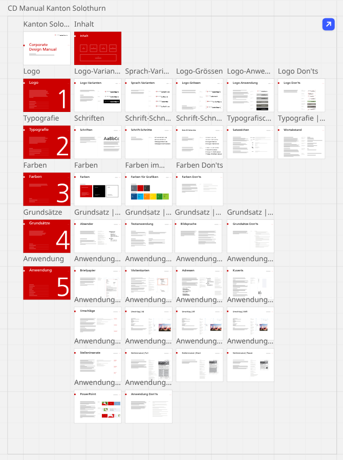

# CD-Manual Kanton Solothurn

Extrakt des Corporate Design Manuals «CD-Manual Kanton Solothurn – Gesamtübersicht,
Arbeitsinstrument für die Verwaltung und die Druckindustrie» vom Miro-Board
<https://miro.com/app/board/uXjVKj6w4cc=/> (Stand der Extraktion: 23.10.2026).

- **[CD-Manual-Kanton-Solothurn.md](CD-Manual-Kanton-Solothurn.md)** – vollständige Abschrift aller 38 Seiten
- **[frames/](frames/)** – Bild jeder Seite (Dateiname = Reihenfolge im Manual)
- **[board-overview.png](board-overview.png)** – Gesamtansicht des Boards

Massgebend bleibt das Original auf Miro; bei Abweichungen gilt das Board.

| Kapitel | Seiten |
| ------- | ------ |
| Titel, Inhalt | [00](frames/00-titel.png), [01](frames/01-inhalt.png) |
| 1 Logo | [Intro](frames/10-logo.png) · [Varianten](frames/11-logo-varianten.png) · [Sprach-Varianten](frames/12-sprach-varianten.png) · [Grössen](frames/13-logo-groessen.png) · [Anwendung](frames/14-logo-anwendung.png) · [Don'ts](frames/15-logo-donts.png) |
| 2 Typografie | [Intro](frames/20-typografie.png) · [Schriften](frames/21-schriften.png) · [Hauptschrift](frames/22-schriftschnitte-hauptschrift.png) · [Zusatzschrift](frames/23-schriftschnitte-zusatzschrift.png) · [Satzzeichen](frames/24-satzzeichen.png) · [Wortabstand](frames/25-wortabstand.png) |
| 3 Farben | [Intro](frames/30-farben-intro.png) · [Farben](frames/31-farben.png) · [Farben für Grafiken](frames/32-farben-fuer-grafiken.png) · [Don'ts](frames/33-farben-donts.png) |
| 4 Grundsätze | [Intro](frames/40-grundsaetze.png) · [Absender](frames/41-absender.png) · [Textanwendung](frames/42-textanwendung.png) · [Bildsprache](frames/43-bildsprache.png) · [Don'ts](frames/44-grundsaetze-donts.png) |
| 5 Anwendung | [Intro](frames/50-anwendung.png) · [Briefpapier](frames/51-briefpapier.png) · [Visitenkarten](frames/52-visitenkarten.png) · [Adressen](frames/53-adressen.png) · [Kuverts](frames/54-kuverts.png) · [Umschläge](frames/55-umschlaege.png) ([A4](frames/56-umschlag-a4.png), [A5](frames/57-umschlag-a5.png), [A6/5](frames/58-umschlag-a6-5.png)) · [Stelleninserate](frames/59-stelleninserate.png) ([Full](frames/60-stelleninserat-full.png), [Short](frames/61-stelleninserat-short.png), [Teaser](frames/62-stelleninserat-teaser.png)) · [PowerPoint](frames/63-powerpoint.png) · [Don'ts](frames/64-anwendung-donts.png) |

---

## Verwendung in digitalen Projekten

Das Manual ist für Verwaltung und Druck geschrieben; für Bildschirme (Websites,
Dashboards, Apps, Präsentationen) gibt es keine eigenen Vorgaben. Die Regeln sind
deshalb sinngemäss zu übertragen – ohne etwas zu verwenden, was das Manual nicht vorsieht.

| Vorgabe im Manual | Sinngemässe Übertragung auf Bildschirm |
| ----------------- | -------------------------------------- |
| Logo nur aus Originaldateien, keine Veränderung ([Logo](frames/10-logo.png), [Don'ts](frames/15-logo-donts.png)) | Logo **nicht nachbauen**; Originaldateien beim Kompetenzzentrum für Publikationsmedien beziehen. Fehlt die Datei, Platz leer lassen – kein Ersatzschriftzug, kein Logo ohne Wappen |
| Farbiges Logo bis 40 % Hintergrund, darüber negativ weiss heraldisch; Wappen in Rot nicht auf mehr als 5 % Hintergrund ([Anwendung](frames/14-logo-anwendung.png)) | Farbiges Logo auf weissem Grund; auf dunklen Flächen (z. B. Dark Mode) die negative Variante |
| Schutzraum X um das Logo ([Grössen](frames/13-logo-groessen.png)) | Freiraum rund um das Logo, keine anderen Elemente im Schutzraum |
| Hausschrift Frutiger LT Std; Hauptschnitte 55 Roman, 56 Italic, 75 Black, 76 Black Italic; Condensed nur in platzarmen Situationen wie Grafiken ([Schnitte](frames/22-schriftschnitte-hauptschrift.png), [Zusatz](frames/23-schriftschnitte-zusatzschrift.png)) | Nur diese vier Schnitte (400/700, normal/kursiv); Condensed nur für Beschriftungen in Grafiken. Ohne Frutiger-Lizenz Fallback Arial |
| Solothurner Rot RGB 204/0/0, Schwarz, Weiss; Grafikfarben Grau 100/107/118, Schwarz 51/51/51, Zusatzfarben ([Farben](frames/31-farben.png), [Grafiken](frames/32-farben-fuer-grafiken.png)) | Alle Farben aus dieser Palette bzw. Tonwerte davon (wie in der PowerPoint-Vorlage, z. B. DodgerBlue4 8 % = `#ECF1F6`); Kontraste nach WCAG prüfen |
| Keine willkürlichen Farben, keine Farbverläufe oder Schattierungen ([Farben Don'ts](frames/33-farben-donts.png)) | Flache Flächen, Haarlinien statt Schatten, keine Verläufe |
| Rotes Quadrat links neben dem Seitentitel, Kapitel-Kennzeichnung «3 FARBEN →» (alle Seiten) | Rotes Quadrat beim Titel; Abschnitte nummeriert mit feinem roten Pfeil |
| Kein zentrierter Satz; Flattersatz; Satzbreite max. ~70 Zeichen ([Textanwendung](frames/42-textanwendung.png)) | Texte linksbündig, Fliesstext auf ~70 Zeichen begrenzt |
| «Guillemets», Halbgeviertstrich für Aufzählungen, %-Zeichen, echte Auslassungspunkte ([Satzzeichen](frames/24-satzzeichen.png)) | UI-Texte mit « », – und …; Listen mit Halbgeviertstrich |
| Absender: Amtsbezeichnung in Frutiger Black Italic, einheitliche Schreibweise ([Absender](frames/41-absender.png)) | Amtsbezeichnung z. B. in der Fusszeile, Black Italic |

### Farbwerte

| Farbe | RGB | Hex |
| ----- | --- | --- |
| Solothurner Rot | 204/0/0 | `#CC0000` |
| Schwarz / Weiss | 0/0/0, 255/255/255 | `#000000`, `#FFFFFF` |
| Grafik-Grau | 100/107/118 | `#646B76` |
| Grafik-Schwarz | 51/51/51 | `#333333` |

Zusatzfarben für Grafiken (DodgerBlue4, DeepSkyBlue2, ForestGreen, Gold, DarkOrange1 …) siehe
[Farben für Grafiken](frames/32-farben-fuer-grafiken.png) bzw. die Abschrift.

**Offener Punkt:** Auf der Seite [Farben für Grafiken](frames/32-farben-fuer-grafiken.png) sind
«DarkOrange 1» und «Gold» mit **R 225** beschriftet, die Farbflächen sind aber mit **R 255**
dargestellt (`#FF8C00` / `#FFD700` – das entspricht auch den Farbnamen). Bis zur Klärung mit
dem Kompetenzzentrum für Publikationsmedien ist unklar, welcher Wert gilt
(`#E18C00` / `#E1D700` gemäss Beschriftung).
